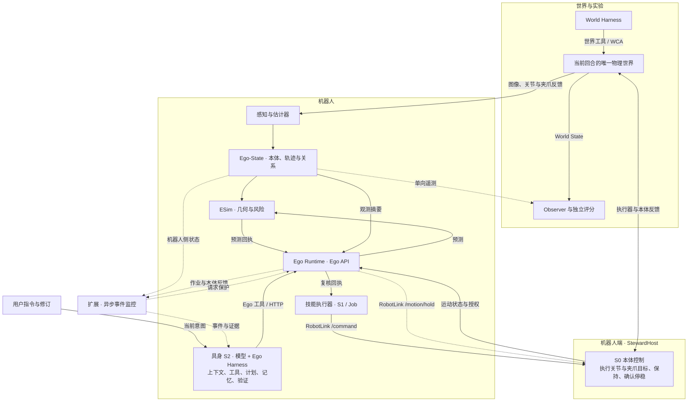
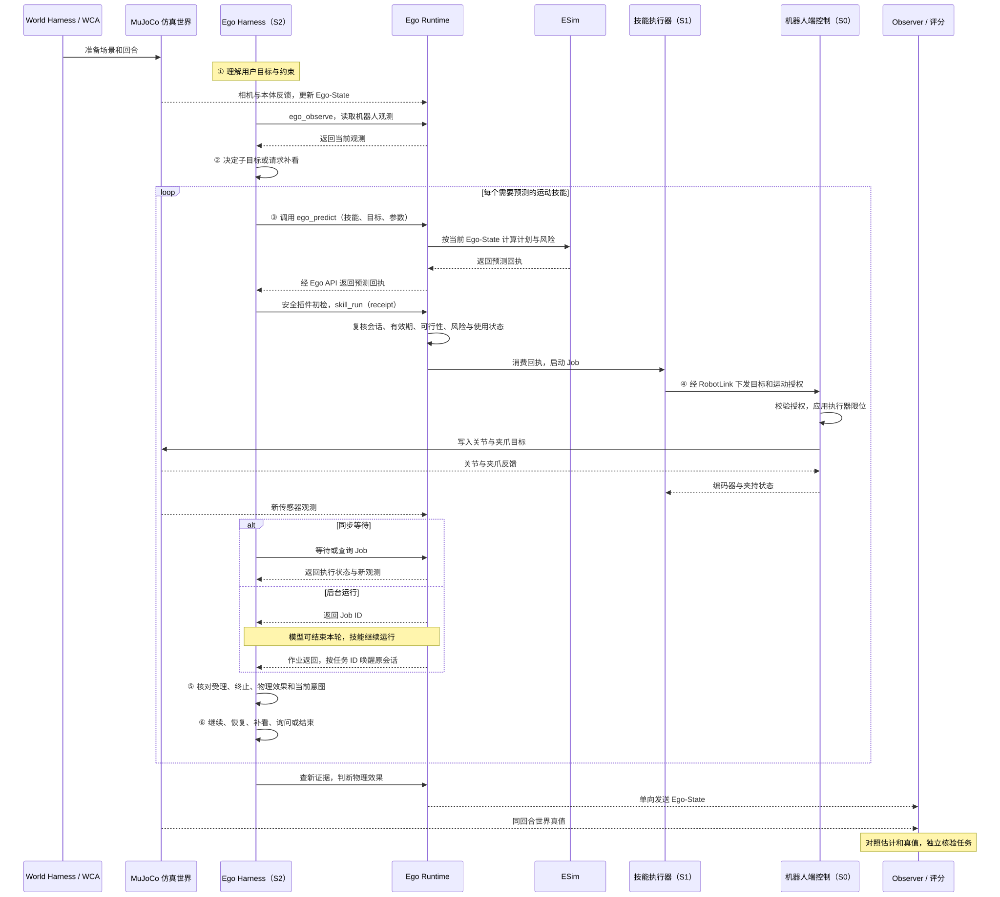
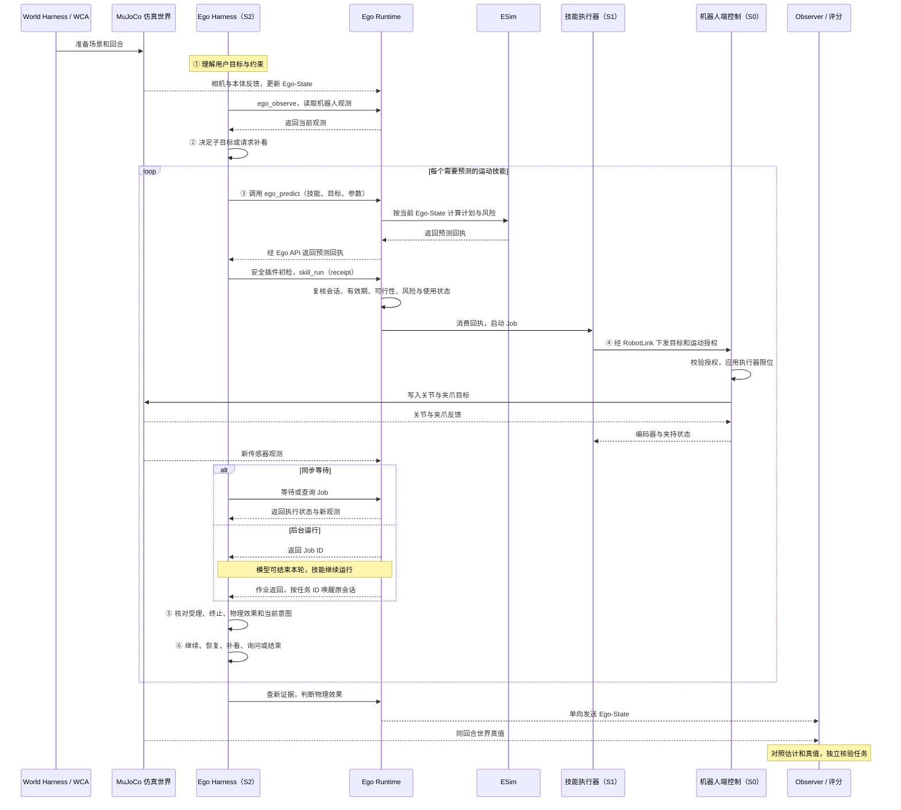
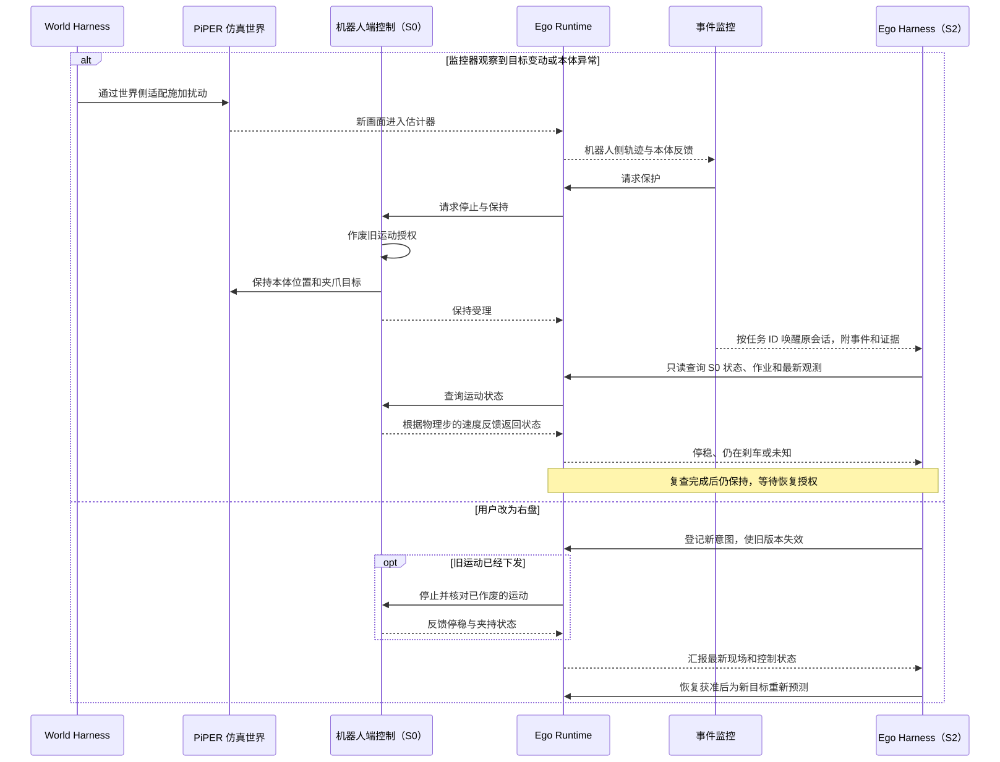
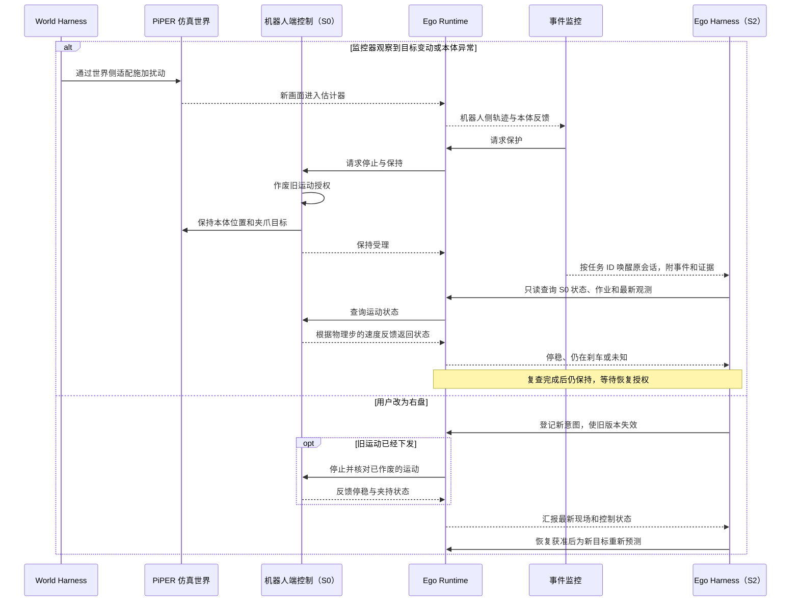

# 双 Harness 逻辑架构与任务时序

## 世界侧与机器人侧

World Harness 是实验员的布景和实验工具。它使用独立 DSH 配置访问世界控制 API（WCA）。Ego Harness 是机器人的高层智能体，包含模型会话、工具编排、安全插件和反思。它通过 Ego API 访问自己的 Runtime。世界真值留在仿真端；实验员移动黑盒后，机器人必须从新的传感器观测发现变化。[World 配置](../../steward/dsh/packages/dsh-bundle-world/cordis.patch.yml) · [Ego 配置](../../steward/dsh/packages/dsh-bundle-ego/cordis.patch.yml)

图中 S2 框列的是目标职责。基线实现入口与待验收缺口见[论文映射表](paper-alignment.md)。论文图 3 的 S2 对应 Ego Harness 中的模型及其编排机制；S1 是它可调用的感知、规划与操作能力；S0 对应构型本地控制和本体接口。Ego Runtime 承载感知、状态、预测和技能执行等多种职责。World Harness 从实验侧控制条件，独立 Observer 用真值评估。保护监控应取机器人可用的信号，不能把 Observer 的真值诊断当成机器人发现异常。[论文 §2](https://arxiv.org/html/2611.18359v1#S2) · [World 服务](../../steward/src/steward/world/server.py)

可编辑图源

**S0 负责执行和反馈。** S1 的技能执行器通过 `RobotLink` 提交本体目标。机器人端的 `WorldSim` 校验运动授权并写入执行器，由 MuJoCo 推进物理，返回关节和夹爪反馈。上图的 S0 框代表机器人端口及控制能力，物理世界框代表它们所作用的仿真环境，两者在当前部署里共用一个 MuJoCo 实例。[命令入口](../../steward/src/steward/world/server.py#L662) · [控制实现](../../steward/src/steward/world/sim.py#L680)

**中断时，S1 取消 Job，S0 停住本体。** 当前仿真中，保护监控调用 Ego Runtime 请求 S0 保持，随后通知原 Ego Harness 会话判断下一步。S0 立即让旧授权失效，保持本体位置和夹爪目标，再通过物理步中的速度反馈确认停稳。已受理保持、Job 已结束、已停稳是三个独立的状态。仿真暂停时停稳状态为未知。恢复需要匹配本次保持的授权，并且旧 Job 已退出。[中断与恢复接口](../../steward/src/steward/ego/runtime.py#L2258) · [S0 仿真验收](../../steward/tests/test_motion_hold.py)

## S2 工具加载与 Console 可见性

Ego Harness 的 profile 控制 **S2 本轮能看到哪些工具**。Ego API 声明 **当前机器人支持哪些技能和本体接口**。Console 取两者的交集，同时显示本轮的操作权限。

### 每轮按会话加载工具

Console 每轮用机器人独立的 `DSH_HOME` 和 `--profile ego` 启动 DSH，已有会话通过 `--session-id` 接续。配置按 bundle、profile 的 `cordis.patch.yml`、Harness home 的 patch、本轮 `--patch` 的顺序应用。本轮 patch 给 `steward-ego-runtime` 注入 Ego API 地址、控制者、任务 ID、已有的意图版本和只读复查标记。`steward-tool-ego` 自己的配置决定是否注册关节和夹爪直调工具。把开关放在该插件下，可让 Console 单独覆盖 Runtime Client 的连接与任务参数。[DSH 配置顺序](../../docs/architecture.md#profiles-and-bundles) · [回合启动](../../steward/src/steward/world/chat.py#L796) · [PiPER profile 配置](deployment.md#运行-bpiper-工作台)

Ego Harness 发起模型请求时，从 `ctx.tools.schemas(agent)` 读取该会话实际生效的工具，向 Console 上报会话 ID、工具名、`ego_predict` 支持的技能参数和只读标记。Ego profile 的工具通过 `run_code` 提供给模型。Console 只采信当前机器人主会话的上报，子会话的工具权限不会覆盖主会话。[Ego profile](../../steward/dsh/packages/dsh-bundle-ego/cordis.patch.yml) · [会话上报](../../steward/dsh/packages/dsh-ego-runtime-client/src/session-tools.ts) · [事件接收](../../steward/src/steward/world/chat.py#L920)

### Console 怎样计算可见性

| Console 区域 | 显示条件 | 只读复查 |
| --- | --- | --- |
| S2 可调用的 S1 技能 | 技能必须出现在 `GET /ego/plan` 的 `availableSkills` 中。预测类技能还要求会话同时拥有 `ego_predict` 和 `skill_run`，且技能在 `ego_predict` 的参数允许范围内。原地巡视 `look_around` 要求 `ego_explore`。 | 保留技能列表，以灰色提示运动技能停用。 |
| S0 本体接口 · S2 直调 | 会话注册的工具名必须同时出现在 Ego API 的 `availableS0Tools` 中。Ego API 按当前机器人已注册的路由列出可用的 S0 工具名，并标记为 `read` 或 `control`。 | `read` 仍可调用，如 `ego_motion_status` 和 `ego_gripper_pose`。`control` 显示为停用，包括 `body_stop`、`body_set_joints` 和 `body_set_gripper`。 |

例如 PiPER 只有固定机械臂，`navigate` 即使出现在 `ego_predict` 的参数枚举里，也不会显示为 PiPER 技能。`pick` 的「双指接触与摩擦」或「理想附着」标签取自仿真后端报告的夹持方式。新一轮开始时页面等待最新上报，结束后保留该轮清单。切换或重置会话时清除旧清单，前端也会等构型和 Ego API 的本体 ID 一致后再显示。已取得的清单为空时，页面提示当前会话未开放相应接口。[构型能力](../../steward/src/steward/ego/runtime.py#L1983) · [S0 接口声明](../../steward/src/steward/ego/server.py#L23) · [交集计算](../../steward/src/steward/world/chat.py#L396) · [页面渲染](../../steward/src/steward/world/console.html#L1118)

### 直调怎样执行

PiPER 的 `allowDirectS0` 默认关闭。显式开启后，S2 可以设置 `joint1` 到 `joint6` 的绝对角度（弧度），也可以开合夹爪。两个工具通过 `POST /ego/body/command` 请求 Ego Runtime 直调 S0。只读复查期间，Runtime Client 在发 HTTP 请求前拒绝控制调用。正常回合中，Ego Runtime 仍会逐次核对控制权、任务与意图版本、运动授权和关节限位，并阻止 S0 直调与正在运行的 S1 作业重叠。动作达到编码器确认条件后返回 `reached`。这条路径没有碰撞规划。监控器通过机器人侧保护路径请求停止，仍可在 S2 只读复查期间保护本体。[工具注册](../../steward/dsh/packages/dsh-tool-ego/src/index.ts#L502) · [只读限制](../../steward/dsh/packages/dsh-ego-runtime-client/src/index.ts#L214) · [直调执行](../../steward/src/steward/ego/runtime.py#L2319)

PiPER 仿真验收通过同一 S2 会话依次执行 `joint1` 转到 `0.20 rad`、闭爪、开爪、回零。四步均返回 `reached`，运行记录中无 S1 作业。回归测试覆盖越限拒绝、作业互斥、按任务停止和只读复查的工具限制。[PiPER 直调回归](../../steward/tests/test_piper_workstation.py#L90) · [Console 会话回归](../../steward/tests/test_chat.py#L114) · [只读工具回归](../../steward/dsh/test/tools.test.mjs#L90)

## S1 技能适配器

参考 Yuan 等人的 Unified Interaction Interface，S1 通过统一的 `SkillRobot` 接口读取本体反馈和提交动作目标。技能负责动作顺序、插值、取消和结果判断，`RobotSkillAdapter` 负责把目标翻译给机器人端，并将本体反馈与同回合的 Ego-State 观测组合起来。S2 仍通过 `ego_predict` 和 `skill_run` 编排技能。[论文 §2.2 与图 3](https://arxiv.org/html/2611.01560v2#S2.SS2) · [适配器](../../steward/src/steward/ego/skill_adapter.py)

| 构型 | 执行方式 | 本体适配 |
| --- | --- | --- |
| Steward 移动机器人 | 复用底盘靠近、末端对齐、抓取或释放流程。 | `Arm` 通过统一入口解释底盘位姿、升降和伸缩目标、腕角与夹爪反馈。Cobot 的平面控制可通过子类换算到物理关节。 |
| 桌面 PiPER | ESim 按构型为 `pick` 和 `place` 绑定关节路点执行。路点流程负责接近、夹持或释放、撤离和反馈核验。 | 适配器提交本体关节角（弧度）与夹爪目标，并提供实时编码器与夹持状态。逆运动学和路径检查由 PiPER 预测器负责。 |

回执的 `jointProgram` 保存路点。执行器依据启动时绑定的技能选择对应流程。运动仍由 Ego Runtime 管理回执、任务与意图、运动授权和停止。适配器读取实时本体状态时使用最近的机器人感知结果作为物体位置，遇到仿真重置时避免把不同回合的状态合并。[路点绑定](../../steward/src/steward/ego/esim.py) · [S1 作业与执行](../../steward/src/steward/ego/skills.py)

两种仿真构型使用同一 `RobotLink`。接 PiPER 真机时，可沿用路点抓放流程。设备端需要提供匹配的关节和夹爪反馈、时钟和停止协议，并重新验证标定、限位、超时和停稳条件。[设备端接入边界](code-changes.md#s0-和-s1-的实现分界)

## 正常执行从 S2 调用技能到 S0 控制

Ego 工具可以由模型在 `run_code` 中组合。`ego_predict` 让 ESim 基于 Ego-State 做几何与风险预测。`skill_run` 执行回执内的计划，默认等到技能返回。传 `wait=false` 可先拿到 Job ID 并结束本轮模型回复，后台作业仍运行。作业返回后，Ego Harness 按任务 ID 唤醒原会话。等待超时后可按原 Job ID 查询，或按原预测回执对账。[工具实现](../../steward/dsh/packages/dsh-tool-ego/src/index.ts#L417) · [任务事件](../../steward/src/steward/world/chat.py)

可编辑图源

## 中途变化与保护

PiPER 已验证运行中改口、目标移位和掉件。原版厨房回归覆盖作业超时保护。监控器在作业运行时采样本体反馈。接近目标期间，它根据连续两次新的 RGB-D 估计判断位置变化。检测到保护事件后先请求 S0 保持，再唤醒原会话做只读复查。任务取消后，Runtime 拒绝该任务迟到的运动请求。未来接入 WAM 时，只有执行器明确返回动作块或阶段，才能按该状态做复查。[事件监控](../../steward/src/steward/ego/monitor.py) · [PiPER 场景与监控回归](../../steward/tests/test_piper_workstation.py) · [后台作业回归](../../steward/tests/test_chat.py)

可编辑图源

