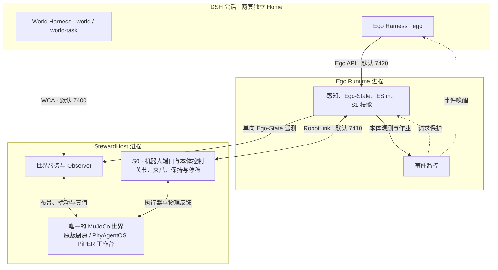

# 仿真部署与 PiPER 接入



每个回合运行一个 StewardHost，由同一个 MuJoCo 实例推进物理。在原版厨房与 PiPER 工作台之间切换场景，会加载对应构型。Observer 在 StewardHost 内初始化。ESim、感知循环、技能执行器和事件监控器属于 Ego Runtime。[进程与服务入口](../../steward/src/steward/cli.py) · [Observer 的归属](../../steward/src/steward/world/server.py#L118)

两种构型的 **S0 都部署在 StewardHost 的机器人端口与 MuJoCo 控制循环里**。Ego Runtime 从该端口提交动作、读取本体反馈和查询停稳。World Harness 通过 WCA 控制布景，Observer 在世界侧独立评分。[机器人端口](../../steward/src/steward/world/server.py#L662) · [仿真控制循环](../../steward/src/steward/world/sim.py#L494)

<details><summary>可编辑图源</summary>



</details>

## 运行 A：先留一份原版基线

在 `steward/` 下按仓库 README 安装 Python 和 DSH 插件依赖。脚本分别准备 `var/dsh/world` 和 `var/dsh/robot-1`。World profile 使用 `dsh-world-client`，Ego profile 使用 `dsh-ego-runtime-client`。机器人只获准使用 Ego 工具。沿用官方入口 `steward up` 启动世界和机器人服务，配置好模型后用 `scripts/run-ego.sh` 下达任务。脚本任务和模型驱动任务分别记录，以便比较。[快速开始](../../steward/README.zh.md) · [profile 安装脚本](../../steward/scripts/setup-dsh-profiles.sh) · [Ego 工具隔离配置](../../steward/dsh/packages/dsh-bundle-ego/cordis.patch.yml)

Console 在机器人启动一轮后显示「S2 可调用的 S1 技能」和「S0 本体接口 · S2 直调」。[工具加载、可见性和只读限制](architecture.md#s2-工具加载与-console-可见性)

点操作员对话标题旁的「查看 Prompt」，可查看当前机器人会话日志里的 System Prompt、本轮输入与注入上下文。

展开「机器人会话 Prompt」可查看当前 DSH 会话记录的 System Prompt、本轮操作员输入及运行时注入的提示。控制台按当前会话 ID 读取，切换会话后会刷新内容。

## 运行 B：PiPER 工作台

从 PhyAgentOS 的 `robot-control-sim` Skill 解包官方 PiPER 资产，保留 `mjcf` 目录下的网格文件。已用版本 `0.1.3` 验证。在 Steward Python 环境中运行下面的命令。[PhyAgentOS 仿真包说明](https://github.com/PhyAgentOS/PhyAgentOS-core/blob/main/docs/quickstart-mujoco_zh.md)

```bash
export STEWARD_PIPER_MJCF=/path/to/robot-control-sim/assets/robots/piper/mjcf/PIPER.xml
steward up --scenario piper-workstation --no-pause-on-perception-fault
```

本工作区已把这套资产放在 `steward/var/phyagentos/robot-control-sim/0.1.3/assets/robots/piper/mjcf/PIPER.xml`。本地启动时可直接运行 `steward up` 命令，环境变量用于选择其他安装位置。版本库只记录适配代码。

要让 S2 直接设置关节角和开合夹爪，在 PiPER 仿真专用的 `robot-1/profiles/ego/cordis.patch.yml` 中加入以下配置。发起下一轮机器人会话后，在 Console 的「S0 本体接口 · S2 直调」查看 `body_set_joints` 和 `body_set_gripper`。

```yaml
- id: steward-tool-ego
  config:
    allowDirectS0: true
```

场景首次加载时生成工作台、黑盒和两个托盘。Steward 用 MJCF `attach` 将原生机械臂和执行器装进同一仿真实例。验证时关闭 World 侧真值告警自动暂停，观察事件从 Ego Runtime 发出。加 `--no-dispatch-task` 可只启动两个服务并手动发任务。[场景入口](../../steward/src/steward/authoring/service.py) · [原生模型接入](../../steward/src/steward/scene/mjcf.py)

| 连接点 | 目标实现与首项检查 |
| --- | --- |
| 机器人侧 | Ego Runtime 使用工作台 RGB-D 估计黑盒和托盘的位置，保留原生腕部相机作为额外观察入口。首版按可见颜色和三维尺寸识别工作台物体。 |
| 世界侧 | WCA 布景、对象编辑、仿真时钟、相机渲染与 Observer 真值使用同一 MuJoCo 实例。机器人侧接收独立的 `e:` 对象 ID。 |
| S0 本地控制 | 六轴目标以弧度提交，机械臂本体反馈包含两个指关节。夹爪驱动按原模型传动比换算。停止、保持、停稳确认及恢复已通过仿真回归。[S0 代码边界](code-changes.md#s0-和-s1-的实现分界) |
| 规划与执行 | ESim 使用模型关节限位、下向 TCP 和插值路径检查生成回执。抓取时优先用物体顶面上方 38 mm 的接近点，无法求解时尝试顶面上方至少 20 mm 的接近点，并检查关节限位与路径。S1 运行抓取、搬运和放置，放下后退回便于观察的姿态。 |
| 物理夹持 | PiPER 沿用原生指碰撞几何、夹爪伺服和双指联动，由 MuJoCo 接触和摩擦搬运物体。双指在同一件物体上产生接触力时，S0 报告夹持。S1 确认夹持后抬起，张开后复查释放。 |
| 回放与评分 | 三条记录用同一回合 ID、仿真时间和作业关联：世界端何时注入扰动、机器人何时观察到变化、动作何时停止。模型等待与网络时延另外记录单调墙钟。真值和扰动脚本保存在 World 侧。 |

在设置 `STEWARD_PIPER_MJCF` 的同一个环境中，可以从 `steward/` 运行 `python -m pytest -q tests/test_piper_workstation.py`。测试覆盖原生本体控制、World 移动物体后的重新定位、正常放置、搬运途中改换目的地、相机断流和掉件停稳。后续真机部署需要分别验证设备控制、停稳和实物验收。[PiPER 集成测试](../../steward/tests/test_piper_workstation.py)

控制台通过世界端口保存操作员偏好。`POST /console/preferences` 接受 `{"key":"default_tray","value":"right"}`，同一个键传 `null` 可删除。用 `GET /console/preferences` 查询当前值，加 `?history=true` 查询更改记录。偏好跟随机器人 profile 跨会话和主机重启保留。执行时优先使用用户最新的明确指令，物体位置来自当前相机观测。[控制台路由](../../steward/src/steward/world/server.py#L492) · [偏好存储](../../steward/src/steward/world/preferences.py)
