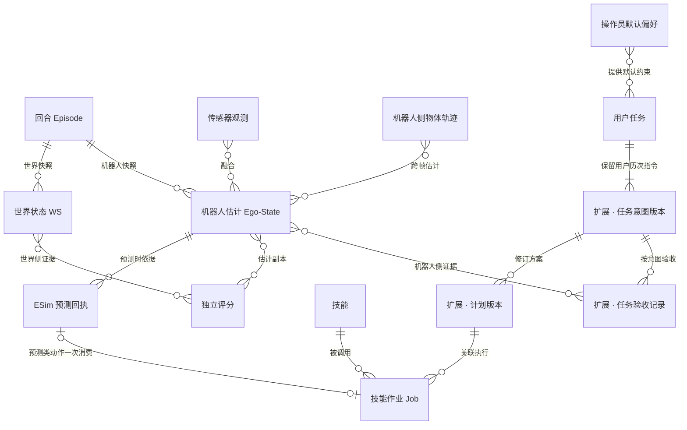

# 领域模型与执行约束

图中“扩展”表示本项目拟增加的关联。World Harness 与 Ego Harness 是参与者，分别通过 WCA 和 Ego API 操作各自负责的对象。图示是领域关系，具体代码采用对象、HTTP 返回或文件记录等不同表示。[术语](../CONTEXT.md)

可编辑图源

## 谁拥有事实

| 所有者 | 负责的事实 | 约束 |
| --- | --- | --- |
| 当前世界后端与 World Harness | 回合、场景种子、世界实体、变更与真值 | 每回合只有一个世界时钟和物理状态。World Harness 请求变更，由后端执行。世界实体 ID 和扰动脚本不得流入机器人决策。 |
| Ego Runtime 的估计器 | 本体状态、机器人分配的物体 ID、位置误差、可见性、上次实测时间 | 相机断流时，本体可继续更新，物体观测时间保持原值。遮挡后证据不足时，关系保持未知。[估计器](../../steward/src/steward/ego/estimator.py) |
| ESim 与 Ego Runtime | 候选动作的预测回执及消费状态 | 复核所属传感器会话、是否已用、有效期、可行性、风险上限和当前意图。PiPER 作业起步前核对目标观测，接近期间由监控器检查目标变化。[回执消费](../../steward/src/steward/ego/runtime.py) |
| 技能执行器与 S0 | 作业 ID、技能、预测引用、运动授权、状态及后置条件 | 技能执行器拒绝并行启动第二个运行中的技能。响应丢失时先按原预测回执查询 Job。S0 独立确认旧授权失效与本体停稳。[Job 与执行器](../../steward/src/steward/ego/skills.py#L162) |
| Ego Harness | 任务 ID、会话关联、操作员偏好 | 任务 ID 关联后台作业产生的事件。操作员偏好可跨任务和进程保留，保存来源、修订和移除记录。物体位置仍使用最新 Ego-State。[会话](../../steward/src/steward/world/chat.py) · [偏好存储](../../steward/src/steward/world/preferences.py) |
| Ego Harness 与 Observer | 前者从现场证据判断意图是否满足，后者在世界侧核对客观结果 | 实验回放同时保存两种结论。验收需要区分受理、终止、物理效果和最新用户意图。 |

## 改口时保留什么

假设黑盒已抓稳，用户把目的地从左盘改为右盘。保留任务和已完成作业，修订意图及后续计划；是否仍持有黑盒由当前证据判断。若左盘动作尚未下发，只废止旧计划。若已下发，拟扩展的控制协议先废止旧代次并请求停止，在队列失效、停稳确认和恢复许可都具备后下发新计划。迟到模型回复按意图和计划版本核对，迟到动作块由执行端按代次核对。

| 观测到的执行情况 | 允许的后续动作 |
| --- | --- |
| 预测不可行、超时或已用 | 重新观察和预测，记录拒绝原因。 |
| Job 仍在运行或等待超时 | 查询原作业和新观测。冲突动作须等待控制权交接。 |
| 请求停止已受理 | 记录请求。PiPER 还要取得停稳和旧队列失效证据。 |
| 远端结果未知 | 按原调用查询；无法确认时保持暂停，请求协助。 |
| 作业终止 | 用新观测验收并选择下一步。验收未知时补观测；独立评分仅供回合结束后复盘。 |
