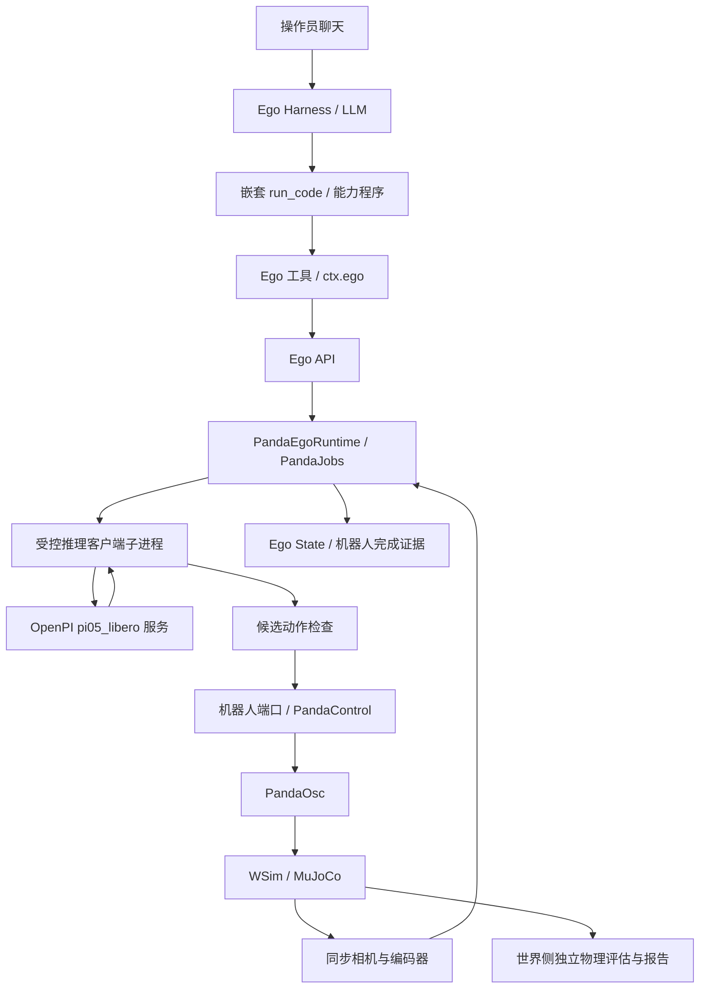

# Steward π0.5 具身操作接入设计

2026-11-13。本文是当前已实现方案的技术参考，覆盖模型、机器人、场景、感知、调用接口、执行与验收。汤罐初态 0 的完整能力链路已有成功证据；多物体入口已开放，固定场景中的任意目标抓放尚未验收通过。逐步实施与原始证据见[实施计划](pi05-integration-plan.md)和[结果索引](README.md)。产品范围见[PRD](pi05-integration-prd.md)，整体架构约束见[Steward 设计说明](../../../steward.md)。

## 1. 当前目标与交付边界

接入目标是让 Ego Harness（EH）从聊天理解任务，通过一个任务级 Job，由机器人侧 Ego Runtime（ER）调用真实 π0.5 持续生成动作，在现有 WorldSim（WSim）中完成接触式抓放。任务编排、策略推理、执行器控制和独立验收分别承担职责。

| 能力 | 当前实现 | 已知验收范围 |
| --- | --- | --- |
| 模型 | OpenPI 的 pi05_libero 预训练权重，独立 GPU WebSocket 服务 | 原始 LIBERO 基线和 WSim 汤罐任务已实测；未训练新模型 |
| 机械臂 | OnTheGroundPanda，7 轴固定基座，Panda 双指夹爪，OSC_POSE | 固定动作、真实接触、停止和基线轨迹对照已有证据；无真机后端 |
| 场景 | LIBERO 汤罐任务的地面、篮子、六种食品及初态 0–4 | 已接入现有 WSim；官方其他任务场景未自动导入 |
| 观测 | 固定外部 RGB-D、腕部 RGB-D、关节/夹爪反馈、编码器 FK | 同步输入、模型预览和 Ego State 可视化已接通 |
| 调用 | 聊天 → 真实 ego profile → 嵌套 run_code／能力程序 → Ego API → Panda Job | 汤罐初态 0 端到端、取消和推理故障有通过证据 |
| 多物体 | pick(target)、libero_pick_place(target,on)，按当前 Ego ID 绑定目标 | 六类别程序准入和动态 prompt 通过；实际策略任意选物体抓放仍有限制 |

原始 LIBERO 的全量评测成绩、固定动作的物理通过、单例端到端成功和多物体程序测试是不同证据，不能合并成“Steward 全量 LIBERO 已通过”。

## 2. 总体结构与进程部署



π0.5 服务只接收观测并返回候选动作，不持有机器人端口、执行器租约或 WCA 权限。ER 管理任务、检查和取消；世界侧拥有物理引擎与最终执行器状态。独立物理评估不把 GT 成功或物体真值回送给机器人作为决策输入。

4090-2 当前部署中，World／控制台使用 7400，Panda 机器人端口为 7410，独立 ER 的 Ego API 为 7420，π0.5 服务为 18065。端口是部署值，Ego API 不是模型接口。CLI 根据本体注册表启动 `panda-ego` 子进程，Panda ER 与世界侧不共享内存或 OpenGL 上下文；复用的是 Ego API、工具与视图约定，Panda 执行栈本身由专用 Runtime 实现。

## 3. 能力分层与模块职责

### 3.1 LLM 能力程序与 π0.5 动作策略

| 层 | 负责的决定 | 不承担的职责 |
| --- | --- | --- |
| EH／LLM | 理解语言，从当前 Ego State 选择目标与篮子，调用工具，解释失败 | 不直接发送电机力矩，不从 World State 获取目标真值 |
| 能力程序 | 固化 predict → run → 查询同一 Job → 检查终态的流程，可跨会话复用 | 能力库统计不替代物理成功率和任务验收 |
| Panda ER Job | 绑定目标、预算、观测和权限；循环观测、推理、检查、执行、停止 | 不把一次模型返回当成任务完成 |
| π0.5 policy | 根据两路 RGB、本体状态、prompt 输出一段七维动作 | 不理解 Ego ID、receipt 或租约；当前没有显式目标框／坐标输入 |
| PandaControl／PandaOsc | 校验控制凭据，按控制周期更新末端目标和夹爪，计算力矩 | 不选择语义目标，不读取任务聊天 |
| WSim／验收程序 | 模拟接触、重力和碰撞，独立评估物理结果 | 不将隐藏目标状态注入策略 |

通用候选模板为 [panda_pick.json](../../../steward/capabilities/panda_pick.json) 和 [panda_pick_place.json](../../../steward/capabilities/panda_pick_place.json)。模板装入真实 profile 的 `robot-home/steward-capabilities/`，由 capability_get 取出后在嵌套 run_code 内运行。已有 `libero_soup_to_basket` recipe 的历史 verified 状态只说明其原有汤罐用途；不能沿用为其他目标的成功认证。能力程序只在 Job 的三个终态字段全部满足成功条件时返回成功，未经真实操作验收的通用模板保持 candidate。

### 3.2 代码归属

| 位置 | 当前职责 |
| --- | --- |
| [embodiments/libero-panda.yaml](../../../steward/embodiments/libero-panda.yaml)、[embodiments.py](../../../steward/src/steward/embodiments.py)、[cli.py](../../../steward/src/steward/cli.py) | 本体登记、Scenario 装配、独立 ER 启停、策略配置传递 |
| [scene/libero.py](../../../steward/src/steward/scene/libero.py) | 校验 LIBERO bundle，加载原生 MJCF、资产和命名初态，登记世界实体 |
| [panda_sensors.py](../../../steward/src/steward/world/panda_sensors.py)、[sensor_cameras.py](../../../steward/src/steward/world/sensor_cameras.py) | 同步相机、编码器、标定和观测标识 |
| [panda_control.py](../../../steward/src/steward/world/panda_control.py)、[panda_osc.py](../../../steward/src/steward/world/panda_osc.py) | Episode／租约／动作凭据、OSC 与停止确认 |
| [panda_runtime.py](../../../steward/src/steward/ego/panda_runtime.py)、[panda_observation.py](../../../steward/src/steward/ego/panda_observation.py) | Ego API、机器人侧观测、FK、状态编码和发布 |
| [panda_jobs.py](../../../steward/src/steward/ego/panda_jobs.py)、[panda_policy.py](../../../steward/src/steward/ego/panda_policy.py)、[panda_prediction.py](../../../steward/src/steward/ego/panda_prediction.py) | receipt、单个策略 Job、推理子进程、动作检查和取消 |
| [panda_perception.py](../../../steward/src/steward/ego/panda_perception.py)、[panda_pick.py](../../../steward/src/steward/ego/panda_pick.py) | 汤罐专用证据、绑定目标的多物体抓放证据与准入 |
| [panda_visual_model.py](../../../steward/src/steward/ego/panda_visual_model.py)、[visual_matching.py](../../../steward/src/steward/ego/visual_matching.py) | 静态类别资产、外观匹配和 Ego 视图补全 |
| [dsh-tool-ego](../../../steward/dsh/packages/dsh-tool-ego/src/index.ts)、[dsh-ego](../../../steward/dsh/packages/dsh-ego/src/index.ts) | 工具参数、ctx.ego 到 HTTP 的适配、receipt／Job 展示 |
| [openpi_step6_infer.py](../../../steward/scripts/openpi_step6_infer.py) | 固定格式请求文件到 OpenPI WebSocket 的实际客户端 |

## 4. 模型、机械臂、场景与观测

### 4.1 模型服务

使用 OpenPI 配置 `pi05_libero`，配套权重位于 `gs://openpi-assets/checkpoints/pi05_libero/`。4090-2 的已验证代码版本、权重校验、客户端／服务端环境和 GPU 信息由 [Step 1 基线](steps/step1-results/README.md)维护；部署中的 `model_id` 为 `pi05_libero@215abfb217dbac7d5f1273282331b9b1866c0479`。该字符串标识配置与代码版本，完整权重身份仍需结合基线 checksum 清单核对。

模型服务与 WSim 分离。服务端加载权重一次并监听 loopback WebSocket；ER 每次启动受控客户端子进程调用该现有服务，客户端进程结束不卸载 GPU 模型。模型端和原始 LIBERO 客户端使用已锁定的独立 Python 环境，避免将 JAX、旧 robosuite 与 Steward 运行依赖混入同一环境。

### 4.2 场景与资产

WSim 使用校验过的 LIBERO prepared bundle，直接保留原生 MJCF 与资产，通过 `MjcfBuild` 接入现有世界运行循环。线上世界不再运行一个外部 LIBERO 环境；原始 LIBERO 只用于导出、基线和隔离对照。bundle 加载会核对 SHA256SUMS，拒绝越界文件引用及校验不匹配，保留惯性、关节、碰撞和接触参数。

完整场景包含地面、篮子、alphabet_soup、salad_dressing、cream_cheese、milk、tomato_sauce、butter。篮子具有真实内部空间和底面承托。带 Panda 的场景名为 `libero-object-alphabet-soup-panda`，其他初态为同名加 `-init-1` 至 `-init-4`；无 Panda 的场景用于早期兼容性验证。所有这些初态仍属于汤罐任务。当前未实现根据 prompt 自动切换为官方奶酪／牛奶等任务场景。

### 4.3 机械臂与物理抓取

本体 `libero-panda` 为固定基座 OnTheGroundPanda，7 个 arm revolute joints，两个对向 finger joints，工具站点为 `gripper0_grip_site`。臂执行器接收 torque，双指执行器接收 position。机器人自有标定描述运动学链、工具、手部、相机和自碰撞／可见几何；从编码器计算 FK，不从世界对象位姿推算机器人观测。

Panda 路径采用接触抓持。夹爪夹住物体依靠接触与摩擦，松爪后物体自然掉落或由篮底承托，不调用旧本体的理想附着。固定动作在原始 LIBERO 和 WSim 的独立复位对照见 [Step 3](steps/step3-results/README.md)和 [Step 4](steps/step4-results/README.md)。该物理通过证据不等于 π0.5 任意任务通过。

### 4.4 机器人观测与模型输入

机器人通过 `GET /sensors/panda/observation` 获取同一仿真步的两路 RGB／毫米深度、关节与夹爪反馈、Episode、step、stamp、calibrationId，以及机器人自有标定。策略执行时还带有 WSim 签发的 observationId。外部槽位 external 对应固定相机 overview，腕部槽位 wrist 对应 robot0_eye_in_hand，两路原始尺寸均为 256×256。

ER 将图像解码为 RGB，并按已核对方向水平翻转，缩放为 224×224；毫米深度转换为米，供 Ego State 和动作检查使用。深度不进入当前 pi05_libero 模型。WSim 的方向处理与原始 LIBERO 图像数组旋转的实现不同，输入对照与误差见 [Step 5](steps/step5-results/README.md)。

| 模型字段 | 格式与来源 |
| --- | --- |
| observation/image | external 的 RGB uint8，224×224×3 |
| observation/wrist_image | wrist 的 RGB uint8，224×224×3 |
| observation/state | 8 个有限数值：[工具站点世界系 xyz，Panda 手部世界朝向轴角 xyz，finger_joint1 位置，finger_joint2 位置]；位置为米，轴角为弧度 |
| prompt | 从 receipt 绑定类别生成，例如 pick up the cream cheese and place it in the basket |

日志中的 `target`、episodeId、step 用于追踪与检查；当前客户端发给模型的只有上述四个字段。Ego ID、目标三维位置、目标框、World State 和任务成功标志均不作为模型输入。具名目标将类别中的下划线换为空格；unknown 使用 selected object，这种通用指令的模型操作能力尚未验收。

### 4.5 π0.5、机器人控制器与 MuJoCo 如何交互

模型当前每次返回 10×7 的 actions，ER 每次执行前 5 个动作后重新观测和推理。原始输出、裁剪值和实际应用回执分别保存。每项有限数值按 [-1,1] 裁剪，再进入预测与执行检查。

| 动作分量 | PandaOsc 映射 |
| --- | --- |
| 0–2 | 世界系末端增量 xyz，每轴缩放为 ±0.05 m，叠加到应用时测得的当前工具站点位置 |
| 3–5 | 世界系增量轴角，每轴缩放为 ±0.5 rad，其旋转矩阵左乘当前工具旋转 |
| 6 | 符号驱动双指开合；负为打开，正为闭合，具体位置由夹爪驱动器限幅 |

控制频率为 20 Hz，每个策略动作覆盖 25 个 0.002 s MuJoCo 子步，即 0.05 s；力矩控制在 500 Hz 物理循环执行。OSC 使用末端误差、雅可比、质量矩阵、阻尼和姿态恢复项计算 arm torque，并按执行器范围限幅。π0.5 不直接输出这些关节力矩。一个候选动作只有收到 matching sequence、controlGeneration、startStep、plannedEndStep 和 endStep 的实际完成回执后才计入 actionsApplied。

### 4.6 Ego State 与可视化

Panda ER 将机器人自模型和观测对象发布成普通 SceneState，继续使用共享的 Ego 视图渲染机制。机械臂由关节反馈恢复姿态；已识别对象用静态类别 mesh／纹理补全外观，位姿与可见性仍来自相机。未识别对象保留观测表面或外观候选，不能从 World State 复制整场景。

当前汤罐／篮子使用任务专用 RGB-D 检测；其他五种食品由可见表面、颜色和高度匹配静态类别模板。类别可标为 inferred，recognitionScore 是匹配误差，不能解释为校准概率。绑定对象暂时遮挡时保留其身份和最近观测，防止抓的是 soup 却显示 butter；这不等于被遮挡时仍能确认抓放成功。静态资产可以用于类别外观和已知机器人模型，不允许把场景 GT 物体名称、布局或实时姿态注入机器人。

## 5. EH 调用的是什么

### 5.1 技能接口与工具调用

Panda 的当前 supported skills 以 `ego_state` 返回的 skills 为准：`pick` 仅接受 target；`libero_pick_place` 接受 target、on，on 必须为当前观察到的篮子。旧名字 libero_pick_place 现已支持不同目标，不意味着已导入所有 LIBERO 任务。单独 place、navigate、pour、open、close 未接到 Panda 栈，不能因通用工具枚举中存在就调用。

具名可选目标为当前六种食品；同样的准入也允许尺寸适合、可见的新鲜 unknown 物体。目标必须是本轮 Ego 对象，lastSeenAgoS≤0.5，尺寸有限且大于 3 mm、最大尺寸≤0.22 m、较窄水平边≤0.08 m，并排除篮子、机器人和环境。篮子也需满足最近真实检测的新鲜度。已有抓持、策略故障锁、控制占用或未确认停止时拒绝新任务。具体入口说明见 [Panda 抓放接口](../../../steward/docs/panda-pick.md)。

下例为能力程序中的嵌套 run_code 内容，选择当前轮 ID；对奶酪能通过程序检查，但实际模型成功尚有限制。示例使用工具返回的 receipt／job 字段，不能与裸 HTTP 的 id 混用。

```javascript
const state = await tools.ego_state({});
if (state.body !== 'libero-panda' || !state.skills.includes('libero_pick_place')) {
  throw new Error('当前本体未开放 Panda 抓放');
}
const targets = state.objects.filter(o => o.category === 'cream_cheese' && o.graspable);
const baskets = state.objects.filter(o => o.category === 'basket' && o.lastSeenAgoS <= 0.5);
if (targets.length !== 1 || baskets.length !== 1) throw new Error('目标或篮子不唯一／不可见');
const pred = await tools.ego_predict({
  skill: 'libero_pick_place', target: targets[0].id, on: baskets[0].id,
});
if (!pred.feasible || !pred.withinRiskLimit) throw new Error(JSON.stringify(pred));
let last = await tools.skill_run({receipt: pred.receipt, wait: true, timeoutS: 240});
const job = last.job;
for (let n = 0; n < 60 && last.state === 'running'; n++) {
  await new Promise(resolve => setTimeout(resolve, 5000));
  last = await tools.skill_status({job});
}
if (last.state !== 'succeeded' || last.goalStatus !== 'achieved' || last.stopStatus !== 'confirmed') {
  throw new Error(JSON.stringify({job, ...last}));
}
return last;
```

工具 `body_stop` 对应 Ego API 的 `/skill/stop`；不要将 HTTP 路径误写成工具名。等待超时只返回同一个 Job 的当前状态，不取消 Job，也不应新建第二个 Job。能力失败后结束依赖步骤并向操作员报告，策略预测拒绝后需由操作员 Reset 解除本轮故障锁。

### 5.2 Ego HTTP API

以下为裸 HTTP，供机器人服务适配和调试使用。EH 正常走工具和 ctx.ego，不通过 shell 绕过权限。API 基址在当前部署为 `http://127.0.0.1:7420`。

| 方法与路径 | 参数／响应要点 |
| --- | --- |
| GET /ego/summary | body、episodeId、objects、self.holding、skills、judgment 和 job |
| GET /ego/query?category=cream_cheese | objects 中的当前 Ego 引用；禁止复制旧轮 ID |
| GET /ego/observation | 当前模型预览，8 维状态与两路 Base64 PNG，不触发模型推理 |
| POST /ego/predict | 请求 skill 和 params；返回原始 receipt，标识字段为 id |
| GET /ego/receipt?id=… | 查询 used、expired、plan、issues 等 |
| GET／POST /ego/control | 查看控制 owner；POST 使用 action=acquire／release 和 owner |
| POST /skill/run | 请求 receipt，可带 owner；返回原始 Job，标识字段为 id |
| GET /skill/status?job=… | 查询同一 Job |
| POST /skill/wait | job、timeoutS；等待上限允许 0–600 s，超时可仍为 running |
| POST /skill/stop | 撤销当前任务，返回 stopped、stopStatus 和可选 job |
| GET／POST /ego/view、GET /ego/view/frame | Ego 视图配置、状态与帧；未配置时没有正常画面 |
| POST /ego/alert、GET /ego/alerts | 将失败、当前步骤和诊断报告给操作员 |

例如预测请求体为 `{"skill":"libero_pick_place","params":{"target":"本轮目标ID","on":"本轮篮子ID"}}`，运行请求体为 `{"receipt":"返回的receipt.id"}`。工具层将预测的 id 投影为 receipt、Job 的 id 投影为 job，并保留 goalStatus、stopStatus、reasonCode、evidence 等结果，当前不对 EH 展示完整原始 plan 的全部字段。

### 5.3 receipt 与 Job 数据

receipt 保存 skill、params、episodeId、controlGeneration、calibrationId、sourceStep、modelId、风险与预算、used 状态；plan 保存选中对象快照 object、目标篮子 destination、完整 prompt、目标 ID、接触支持 ID、覆盖说明和执行前缀限制。准入时只检查当前观测及静止动作的初步覆盖，不预测未生成的整段模型轨迹；运行期间继续逐前缀和逐动作检查。

receipt 一次性使用，默认墙钟有效期 30 s。expiresAt 展示值来自仿真 stamp 加有效期，真正失效同时使用 monotonic deadline、Episode、控制代次和运行前的精确 sourceStep／标定核对；不能只看展示时间。run 在校验后创建 Job、获得执行器租约并绑定观测目标。HTTP 与工具结果的字段差异不能改变这些执行校验。

### 5.4 ER 到机器人端口

机器人端口在当前部署为 7410。该接口只由 ER 管理，不作为 EH 的通用 HTTP／shell 工具开放；Panda 的普通 `/command` 会拒绝控制请求，必须使用专用控制通道。

| 方法与路径 | 参数与语义 |
| --- | --- |
| GET /sensors/panda/observation | 可带 episode、after；未变化返回 unchanged，否则返回同一步 RGB-D、编码器、标定与策略观测标识 |
| GET /control/status | 当前 Episode、controlGeneration、lease 状态、step、pending、lastApplied／lastCompleted、stopState 与速度反馈 |
| POST /control/acquire | 当前 episodeId／controlGeneration、ttlS、policy=libero-task；获取新一代 leaseId |
| POST /control/renew | episodeId、controlGeneration、leaseId、ttlS，维持墙钟租约 |
| POST /control/action | 同组凭据、递增 sequence、七维 action、当前策略 observationId；接受进 pending 不等于动作完成 |
| POST /control/stop | 使用当前凭据撤销代次和未完成动作，物理停稳需继续查询观察 |
| POST /clock/wait | hold、until（仿真秒）、timeoutS 等，协调固定步数推进；不授予执行器权限 |
| POST /clock/renew、POST /clock/release | 维护／释放时钟 hold，不替代 control lease |
| POST /telemetry | 发布带当前 episodeId 的 Ego SceneState，世界侧仅将其用于观察和展示 |

世界侧对陈旧 Episode／代次、错误 lease、重复 sequence、占满的 pending 槽和过期 observationId 返回冲突；非法动作或参数返回参数错误。有效 observationId 的仿真步覆盖范围最多对应当前授权前缀，且另有墙钟期限。ER 以完成回执而非提交成功作为执行计数依据。

## 6. ER 如何执行一次技能

### 6.1 单次执行流程

1. 从机器人端口读取同步观测，更新 Ego State；按 target／on 选择当前对象，并形成 receipt 与动态 prompt。
2. run 复核 receipt、owner、Episode、sourceStep、标定、故障锁和空闲状态，建立唯一活动 Job，获取执行器租约并持有仿真时钟。
3. 读取并记录观测，启动推理客户端；在模型等待期间维持时钟 hold 和执行器租约。
4. 验证模型输出为有限七维动作序列，裁剪后检查前缀，再在每个实际控制 tick 前用当前观测复查该动作。
5. 提交一条动作，等待精确的 25 个子步及实际完成回执，计数并记录新观测。执行至多五条后丢弃余下预测，重新推理。
6. 目标证据达成、操作员取消、预算耗尽或错误时撤销控制，继续观察物理停稳，并复查抓持／放置是否保持。
7. 发布 Job 的终态、目标结论、停止结论、原因和证据，写入记录，释放时钟和执行线程。

每个 Runtime 只允许一个活动策略 Job。控制 owner 的逻辑占用、世界侧执行器 lease、时钟 hold 是三种不同机制：分别约束谁可发起任务、哪一代动作可应用、仿真是否推进，不能相互替代。

### 6.2 如何调用 π0.5

ER 的 `panda_policy.infer` 将同步输入写入 `prefix-NNN/observation.json`，图像在该文件中编码为 Base64 PNG，随后以参数数组启动配置中的 client_command，并追加 policy port、observation 路径、inference 输出路径。当前命令为 pi05-step1/client.sh 包裹 openpi_step6_infer.py；client.sh 选择锁定的 OpenPI 客户端环境。

客户端验证并解码输入，实际通过 OpenPI WebsocketClientPolicy 发送 NumPy 数组。下例说明模型调用接口；它只做推理，不执行机器人动作，依赖已安装的固定版 openpi_client：

```python
import numpy as np
from openpi_client.websocket_client_policy import WebsocketClientPolicy

policy = WebsocketClientPolicy('127.0.0.1', 18065)
reply = policy.infer({
    'observation/image': external_rgb_224,       # uint8, shape (224, 224, 3)
    'observation/wrist_image': wrist_rgb_224,    # uint8, shape (224, 224, 3)
    'observation/state': np.asarray(state8, dtype=np.float64),
    'prompt': 'pick up the alphabet soup and place it in the basket',
})
actions = np.asarray(reply['actions'])          # 当前权重为 (10, 7)
```

这里是 OpenPI 的 WebSocket／NumPy 协议，不是 HTTP `/infer`，也不是直接发送 Base64 JSON。ER 目前配置的是本机 loopback 端口；跨机器部署模型、TLS、鉴权、连接池和并发推理调度尚未实现为产品接口。正常路径由 ER 管理子进程超时和取消，EH 不直接调用模型服务。

### 6.3 时钟、取消与迟到响应

当前验证使用 freeze-idle 时钟：没有活动 hold 时世界冻结；策略推理阶段世界不为等待 GPU 而自由前进，每条动作仍覆盖固定物理时间。speed=1 不等于持续实时推理验证。hold 和 lease 由独立 keeper 续期；策略租约 TTL 为 30 s。

取消会先设置 Job 的取消事件并撤销控制代次，清除未应用动作；推理子进程被终止，必要时 kill。迟到回复和旧 observationId 不能继续提交。停止清理在墙钟 stop_wall_s 内推进物理观察；当前至少观察约 1 s 仿真时间，并可继续至最多约 5 s 的观察窗口，最终以速度条件判断停稳。stopStatus 未确认时阻止后续控制。

Episode Reset 使旧代次、lease、receipt 和对象引用失效，并重新建立 ER 观测与初始场景。Reset 是操作员世界侧动作，不是允许 EH 为绕过故障锁自行清除状态的工具。

## 7. 动态动作如何经过安全检查

| 层 | 当前检查与责任 |
| --- | --- |
| 输入／观测 | 必需两路 RGB、本体状态、同步 Episode 和 step、标定标识；检查缺帧与状态有限性 |
| receipt | 当前目标与支持面、观测新鲜度、owner、一次性使用、有效期、风险与初步覆盖 |
| 模型回复 | 非空、足够长、七维、有限值；保留 raw 输出再裁剪 |
| PandaPrediction | 编码器 FK、差分关节预测、关节限位、每次关节预测变化上限、可见自由空间、点云障碍与 arm/tool sweep |
| 任务授权 | 末端范围 x/y∈[-0.32,0.32] m、z∈[0.025,0.43] m；单前缀累计平移命令≤0.25 m；接触豁免仅对应选中目标和目标篮子区域 |
| 世界侧执行 | episodeId、controlGeneration、leaseId、TTL、sequence、observationId、新鲜观测覆盖的动作步数和执行预算 |
| 结束与恢复 | 撤销后无旧动作续跑；物理停稳窗口，检查时钟／keeper／线程清理；不确认则锁住控制 |

机器人可见点云先去除标定的自身可见几何，再用近似 FK 线段与点云检查扫掠；不是整个场景的精确动力学规划。当前风险分数依据观测 clearance 计算并受 0.35 上限约束，不是经统计校准的碰撞概率，也不能代表整轮成功概率。原生碰撞实体仍由 MuJoCo 模拟。

`prediction_rejected` 会记录同一 Episode 的策略故障锁，后续 pick 与复合抓放都拒绝，需 Reset 后重新开始；调用 stop 只处理停止，不解除该锁。其他错误仍按 blocked、租约和观测状态决定是否可重新预测，不能将所有失败都解释为同一恢复动作。

奶酪诊断确认本次下一动作存在保守误拦：近似预测拒绝，而隔离的真实 OSC／碰撞几何重放没有产生接触。该已知差距尚未修改算法修复；不能因为模型走错目标就放宽全局阈值。细节见[原始 LIBERO 与 Steward 对照](steps/multi-object-pick-place-results/diagnosis/README.md)。

## 8. 结束、成功与失败分别表示什么

### 8.1 Job 状态

Job 对象继承 id、skill、receipt、state、message 等字段，并补充 episodeId、phase、goalStatus、stopStatus、reasonCode、evidence、actionsApplied。运行阶段包括 starting、waiting_inference、checking_actions、executing_actions、stopping、finished。

| 字段 | 取值与含义 |
| --- | --- |
| state | running／succeeded／failed／stopped；stopped 表示取消后确认停止，不表示目标达成 |
| goalStatus | achieved／not_achieved／unconfirmed；缺乏证据保留未确认 |
| stopStatus | unknown／confirmed；任务终止与物理停稳分别记录 |
| reasonCode | goal_achieved、cancelled、prediction_rejected、invalid_action、inference_timeout、execution_limit、episode_changed、lease_lost 等具体原因 |

只有 `state=succeeded`、`goalStatus=achieved`、`stopStatus=confirmed` 全部满足，能力程序才能返回成功。错误停止后仍需报告目标和停止两个结论。停止观察期间丢失原先已达成的抓持／放置证据，会改为未确认，不能沿用停止前的成功。

### 8.2 机器人如何确认完成

汤罐复合任务保留专用证据：外部 RGB-D 的罐体抬升与末端耦合、开爪释放、腕视角可见罐顶位于篮沿之下、撤爪及稳定窗口。它与通用目标跟踪器的条件不同，不能将汤罐专用 lid 检测用于所有物体。

单独 pick 和非汤罐复合任务绑定 receipt 中的对象。抓起要求固定外部相机的真实目标连通区域抬升、非空闭合宽度、目标与工具运动一致、稳定相对位置及至少两帧独立深度变化；腕相机继续进入 policy，但不单独确认多物体抓起。重复帧、静止同色表面、手部扫过目标和遮挡不足以确认抓持。只 pick 的成功表示停止后仍持有目标。

非汤罐放置要求此前已确认抓起，再开爪、撤离、目标持续可见且稳定、篮子当前可见且与绑定对象一致；按当前篮子位置与 rim、目标尺寸和底部高度估计判断落在篮内。相对任务初始深度需要新增占据证据，防止用篮内原有同色物体替代丢失目标。该识别已通过合成 RGB-D 正负例和系统接口测试，仍需要更多真实模型回合、遮挡、旋转和物体组合验收。

### 8.3 世界侧独立验收

世界侧记录双指接触、物体抬升与搬运、松爪、篮内位置、篮底接触、撤爪后的稳定承托和控制停止。它可以读取真实物体状态用于实验对照，但不能回送为机器人证据。官方 LIBERO 的 check_success、世界侧物理成功和 ER 自动目标结论要分别保存，尤其不能用基准终止时的 success 替代撤爪后承托验证。

### 8.4 失败分类与处理

- 观测缺失、目标过期或识别歧义：不发起运动，等待可用的机器人观测。
- receipt／控制凭据失效：拒绝运行或提交动作，不能复用旧轮 ID 与观测标识。
- 模型超时、不可用或输出非法：结束依赖执行，撤销当前控制并检查停止。
- 预测拒绝：记录拒绝点和模型动作，停止并锁住本轮策略，保留现场供诊断。
- 未抓起、掉落、篮外或证据不足：如实返回 failed／not_achieved／unconfirmed 的组合，不自动宣称完成。
- 停止或清理未知：保持 blocked，先确认物理和执行线程状态，再允许后续控制。

## 9. 配置、部署、日志与重放

### 9.1 配置分工

| 配置 | 所属与作用 |
| --- | --- |
| Scenario／prepared bundle | 世界侧资产、物理模型、任务布局、初态和校验清单 |
| libero-panda 本体登记 | 机构、执行栈、传感器槽位及仿真支持；real_backend=none |
| Panda 标定 | 机器人运动学、相机内参外参、自几何和工具站点 |
| policy.toml | ER 调用哪个客户端与模型端口，以及前缀、动作／时间预算 |
| World／robot harness home | WH／EH 命名 profile、会话与持久能力库；与模型权重目录分离 |

当前策略配置如下；路径是 4090-2 的部署示例，迁移机器时应修改配置并重新核对版本与资产，不把这些路径硬编码到能力程序。

```toml
[policy]
client_command = ["bash", "/home/huawei/hqk/workspace/pi05-step1/client.sh", "/home/huawei/hqk/workspace/steward/steward/scripts/openpi_step6_infer.py"]
port = 18065
model_id = "pi05_libero@215abfb217dbac7d5f1273282331b9b1866c0479"
request_timeout_s = 15.0
max_actions = 280
max_wall_s = 420.0
prefix_size = 5
receipt_wall_s = 30.0
stop_wall_s = 20.0
```

省略 policy 配置时，Panda ER 为观测／展示模式，不开放可执行策略技能。当前 CLI 启动装配方式如下，执行前确认这些端口空闲；对正在运行的服务应通过已有管理流程停止后再启动，不重复占用端口。

```sh
cd /home/huawei/hqk/workspace/steward/steward
live=$(cat var/pi05-live-current.txt)
MUJOCO_GL=egl OPENBLAS_NUM_THREADS=1 .venv/bin/python -u -m steward.cli \
  --root var/step4/wsim-root up \
  --scenario libero-object-alphabet-soup-panda \
  --wca-port 7400 --robot-port 7410 --api-port 7420 \
  --panda-policy-config "$live/policy.toml" \
  --world-harness "$PWD/var/dsh/world" \
  --robot-harness "$live/robot-home" \
  --freeze-idle --no-dispatch-task --seed 0 --speed 1
```

原始 OpenPI 服务与权重的安装启动方法由 [Step 1 复现手册](steps/step1-results/REPRODUCE.md)维护。当前 18065 是已经单独启动的模型服务，以上 up 命令不会代为加载模型；DeepSeek key 用于 EH／WH 的 LLM 调用，与本地 π0.5 权重推理分开。机密不进入配置样例、能力程序或提交的日志。

本机访问使用 `ssh -N -L 17400:127.0.0.1:7400 rtx-4090-2`，打开 `http://127.0.0.1:17400/console`。该转发只提供控制台访问，不把模型或机器人内部端口额外暴露给外部。

### 9.2 记录与动作重放

每个 ER 输出目录包含 API 输入与 policy-jobs/<Job ID>/。Job 内保存 receipt.json、job.json、每个 prefix 的 observation.json／inference.json／prediction.json／client.log、actions.jsonl、submissions.jsonl、observations.jsonl、latest-judgment.json、stop.json、external／wrist 原始 PNG，以及 sensors 的 RGB-D／编码器／标定快照。实际文件由运行进度决定：在推理或预测失败前未到达的阶段可能没有对应文件。

actionsApplied 只计实际完成动作，不能用请求数或输出 chunk 长度推断。动作复放须固定相同场景 bundle、初态、控制器、物理步长和已应用动作；仅重新调用模型不能保证复现同一随机轨迹。世界侧 GT、双机位录像和评估报告另存并关联 Job。原始运行目录与报告路径应明确记录，不依赖一个 live-current 指针查找历史结果。

## 10. 验收口径与当前结果

### 10.1 原始环境基线

原始 LIBERO 用于证明权重、任务与本体配套可运行，并测量模型在官方各自场景下的成绩。历史官方奶酪任务为 50/50；当前同一服务的两次官方奶酪对照均成功。它们不构成 Steward 固定汤罐布局的奶酪成功记录。

### 10.2 已完成的分层验证

| 阶段 | 实测证据 | 对结论的限制 |
| --- | --- | --- |
| Step 1 | [原生基线与固定批次](steps/step1-results/README.md) | 官方任务布局，非 Steward 运行成绩 |
| Step 2–3 | [兼容性](steps/step2-results/README.md)、[Panda／OSC](steps/step3-results/README.md) | 资产、运动与控制匹配，不代表策略完成任务 |
| Step 4–5 | [固定动作物理](steps/step4-results/README.md)、[观测和 Ego State](steps/step5-results/README.md) | 真实接触和同步输入；非模型成功率 |
| Step 6–7 | [真实闭环](steps/step6-results/README.md)、[聊天／能力／取消／故障](steps/step7-results/README.md) | 指定汤罐场景，冻结推理时钟 |
| Step 8 | [初态 0 单例端到端](steps/step8-results/README.md) | smoke-03 通过；多初态稳定成功率与全量识别负例仍待验收 |
| 多物体 | [pick](steps/multi-object-pick-results/README.md)、[抓放与原生对照](steps/multi-object-pick-place-results/diagnosis/README.md) | 程序入口开放；固定布局任意目标实际能力未通过 |

### 10.3 模型能力与集成问题分开报告

原生汤罐布局改奶酪指令及奶酪目标判据，在原始 LIBERO 中六次均未成功，其中五次详细记录都显示汤罐入篮、奶酪未入篮。这个问题不依赖 Steward 的碰撞检查；模型在这组场景／语言组合中没有正确切换目标。WSim 中另有下一动作预测偏保守的独立问题。完整数据、八段对照录像和复现脚本见[奶酪诊断](steps/multi-object-pick-place-results/diagnosis/README.md)。

### 10.4 成功率评测口径

运行前固定任务、场景／初态、种子、模型及代码身份、时钟模式、动作与墙钟预算、次数和计数规则。分别统计官方基准成功、WSim 世界侧物理成功、ER 目标证据、停止确认和完整能力链路成功；失败、异常、超时、人工干预全部保留在原批次分母，故障注入与取消单列。

一次端到端成功只证明该组合贯通。能力库的 verified、静态／合成测试通过、空动作测试策略和原始 LIBERO 成绩不能替代真实 π0.5 的本地重复批次。当前 Step 8 按用户确认收敛为初态 0，未约定稳定成功率最低阈值，也未完成多初态／多目标通用成功率验收。

## 11. 维护与验证入口

修改模型适配时核对两路真实模型输入、8 维状态、动作单位和模型身份；修改本体／场景时先运行原始对照和固定动作验证；修改 Job／工具时覆盖所有者、凭据、取消、Reset、超时、轨迹拒绝和停止；修改识别时覆盖遮挡、同色替身、静止表面、空抓、篮外和新增占据证据。GUI 展示按普通 SceneState 渲染路径验证，不用 GT 复刻 Ego 场景。

当前相关回归与工具入口：

```sh
cd /home/huawei/hqk/workspace/steward/steward
MUJOCO_GL=egl OPENBLAS_NUM_THREADS=1 .venv/bin/python -m pytest \
  tests/test_panda_pick.py tests/test_panda_jobs.py -q
cd dsh
export PATH=/home/huawei/hqk/workspace/steward/steward/var/dsh-toolchain/bin:/home/huawei/hqk/workspace/steward/steward/var/dsh-toolchain/node/bin:$PATH
pnpm run build
node --test test/tools.test.mjs test/panda-pick.test.mjs test/panda-pick-place.test.mjs
```

真实 GPU 复现命令由各步结果与诊断报告维护；不要为提交文档而重复模型评测。检查结果应报告实际执行的命令和范围，不能将已知旧场景基线失败或全仓文档问题标为通过。

## 12. 后续设计与未完成项

1. 将官方奶油奶酪等任务的对应场景和初态导入 WSim，建立同任务、同布局的模型对照，避免仅换 prompt 就宣称支持了整个任务集。
2. 用实际碰撞几何、OSC 控制响应和负例校准 PandaPrediction，解决近似扫掠误拦；继续保留执行凭据、停止确认和可观测障碍约束。
3. 为固定场景任意目标操作单独验证语言目标定位；若引入目标框、坐标或其他条件输入，需要匹配支持该输入的策略和训练／适配方案，不能只把额外 JSON 字段传给现有模型。
4. 扩展真实多目标、多初态、遮挡及目标旋转的证据验收，补齐独立 place 和跨多个策略 Job 的编排后再声明对应技能支持。
5. 独立验证持续实时推理时钟、跨机器模型部署、并发与鉴权；真机控制后端另行设计，当前不提供实机部署能力。
