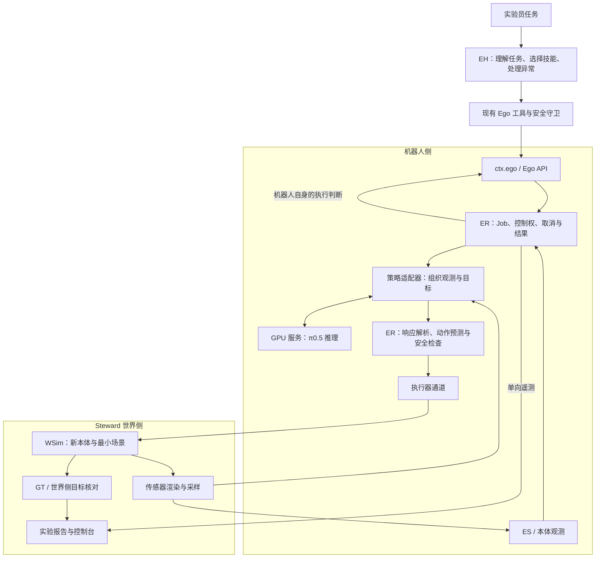

# Steward π0.5 具身操作接入设计

状态：设计提案，尚未实现。日期：2026-11-05。

需求依据：[接入 PRD](pi05-integration-prd.md)。架构约束：[steward.md](../../../steward.md)。本文统一维护接入方案与单阶段完整任务验收的技术设计；所选权重、机器人资产和控制参数仍需通过独立基线核实。

## 1. 要解决的问题

Steward 已经可以让 EH 使用机器人工具理解任务、预测风险并执行技能。现有 ER 把 `pick`、`place`、`open` 等技能转成针对 `steward_bot` 的显式运动过程。本次增加一种技能执行方式：由 π0.5 根据相机、本体观测和操作目标连续生成动作，由 ER 检查并执行。

真正需要接入的是完整的观测与动作循环，而不只是一次模型请求。模型预处理、机器人机构、相机视角、动作单位、执行周期、结束判定和安全检查中的任何一项不匹配，都可能出现“接口调用成功，但机器人没有完成任务”。

首期直接使用 π0.5，在 Steward 内新增与权重匹配的机器人及最小场景，保留原有 `steward_bot`。首期只验收一次完整任务，由 EH 发起一个技能 Job，π0.5 在其中完成抓取、搬运和放置等动作。EH→ER 保持统一的技能调用语义；具体本体的状态与动作向量不要求相同。

### 已确定与尚未确定的事项

| 事项 | 结论 |
| --- | --- |
| 策略路线 | 直接 π0.5，不实现 ACT 过渡 |
| 首期本体 | 新增与选定权重匹配的本体，不把 π0.5 动作强行映射到旧机器人 |
| 运行资源 | 用户有 Linux NVIDIA GPU 机器，具体配置后续补充 |
| 支持范围 | 明确列出的基准操作，不承诺任意任务 |
| 候选权重 | OpenPI `pi05_libero`；尚未完成版本、本体资产与任务可拆分性的验证 |
| 执行入口 | 复用 `ctx.ego`、Ego API 和 ER 技能 Job |
| 验收依据 | 真实 π0.5 驱动仿真；机器人判断与世界侧 GT 评估分别记录 |

## 2. 当前系统里已经有什么

以下是当前代码事实，不是本次需要重建的组件。

| 模块 | 当前行为 | 对新策略的影响 |
| --- | --- | --- |
| `EgoRuntime` | 持续感知、维护 ES、生成与核验 receipt、管理独占控制 | 继续作为技能执行的拥有者 |
| `SkillExecutor` | 接收 receipt 的计划，在独立线程里驱动运动；返回 ER Job | 扩展策略执行方式，不另建绕过它的控制入口 |
| `Esim` | 从 ES 生成显式技能计划、风险与 receipt | 当前能力不能自动覆盖新本体和 VLA 动作 |
| `RobotLink` | 获取传感器与相机、发送执行器指令、协调仿真时钟 | 作为策略观测与动作的既有通道 |
| `ctx.ego` 适配层 | 通过 HTTP 调用 Ego API | 保留现有传输；本次不迁移 gRPC |
| Ego 工具 | `ego_predict`、`skill_run`、`skill_status`、`body_stop` 等 | EH 继续使用这些任务级入口 |
| `dsh-robot-safety` | EH 侧审查 receipt，ER 执行前再核验 | 新策略必须接入同样的双层检查 |
| Ego bundle | 禁用 shell、文件、网页、workflow 和 `tool-jobs` 等通用工具 | 不为新策略重新开放这些入口 |
| WSim / Observer | 世界侧运行物理、保存 GT 并评估 ES 和任务 | GT 评估不能参与机器人决策 |

现有 Job 状态为 `running / succeeded / failed / stopped`。`skill_run` 默认等待结束，也支持先返回 Job 后查询。这里使用的是 ER 自己的技能 Job，不是上游 Harness 的后台 Jobs。

### 2.1 现有本体如何抓取物体

`steward_bot` 的抓取由规则式技能和 WSim 的 Phase 0 理想夹爪共同完成。高层 LLM 负责选择目标和技能，底层动作由几何规则和显式控制代码生成。当前抓取链路没有学习型操作策略。

1. **EH 选择目标并请求预测。** EH 从机器人自己的 Ego-State 选取目标，调用 `ego_predict` 预测 `pick`，再用 `skill_run` 提交预测凭据。[Ego 工具](../../../steward/dsh/packages/dsh-tool-ego/src/index.ts)
2. **ESim 生成抓取计划。** ESim 检查目标是否可抓、支撑面是否已知、底盘能否靠近，并根据目标位置的不确定性估算抓空风险。计划给出靠近位置、夹爪高度和抓取后的搬运高度。[抓取预测](../../../steward/src/steward/ego/esim.py)
3. **ER 控制底盘与夹爪。** ER 让底盘靠近并横向对齐，根据目标估计调整升降和伸缩。夹爪与目标的水平距离在容许范围内时，ER 下发闭合指令，再读取 `holding` 遥测。抓空时张开夹爪、收回并后退。检测到持物时，ER 将目标轨迹标为持有并抬升。[抓取执行](../../../steward/src/steward/ego/skills.py)
4. **WSim 用理想附着模拟抓持。** 夹爪闭合时，WSim 按世界侧几何规则在捕获范围内选取符合条件的物体，记录物体相对夹爪的位姿，使物体刚性跟随夹爪。张开时解除附着，物体恢复自由运动。这个机制省略了通过夹爪接触、夹紧力和摩擦维持抓持的过程。对普通物体，机器人侧的 `holding` 反映仿真附着状态，物体身份仍由机器人依据自身观测估计。[理想夹爪与遥测](../../../steward/src/steward/world/sim.py)

π0.5 接入 ER 的动作生成路径。新本体仍需逐项验证场景转换、WSim、估计器、ESim 与执行器中的机构假设。若候选权重依赖夹爪接触动力学，需要用配套夹爪和控制器验证抓持与反馈，详见 [新本体适配](#43-当前代码需要解除的本体假设)。

## 3. 总体结构与修改范围



π0.5 服务只负责“一份观测与目标 → 一段候选动作”。它没有执行器权限，不决定世界步进，也不调用 WCA。ER 保持唯一的执行控制权，并负责把候选动作变成经过检查的执行器命令。

修改集中在下列现有模块，新增模块名称在实现时固定：

| 位置 | 计划修改 |
| --- | --- |
| `steward/src/steward/ego` | 增加 π0.5 策略适配、受限动作执行、观测完成判定与策略记录；扩展运行时配置 |
| `steward/src/steward/ego/skills.py` | 接入新执行方式，复用单技能运行、Job、取消和结束通知 |
| `steward/src/steward/ego/esim.py` | 增加所选本体与候选动作的风险检查，不能复用旧本体检查后直接放行 |
| `steward/src/steward/world`、`scene`、`assets` | 加入匹配的本体与场景，补足传感器和执行器支持，增加世界侧验收 |
| `steward/dsh` | 必要时扩展技能参数、结果字段与工具说明，并更新全部消费者、测试和配置快照 |
| `steward/tests`、DSH 适配测试 | 覆盖新控制路径、故障、隔离、回放与既有本体回归 |

不修改上游 `packages/`、agent loop、会话格式、根工作区和上游检查脚本。ER、WSim、策略适配与场景模块不引入 DSH 依赖。EH 与 WH 仍通过各自命名 profile 启动，使用隔离的运行目录和权限。

## 4. 先固定权重、本体和任务，再固定动作接口

### 4.1 配套选型

选型结果必须是一组可运行的配置，而不是单独一个 checkpoint 名称。

| 项目 | 必须固定的内容 | 不匹配时的处理 |
| --- | --- | --- |
| 模型 | 权重版本、推理代码版本、模型配置、归一化统计 | 停止加载，不能静默替换权重 |
| 机器人 | 机构、关节顺序、关节与夹爪范围、工具坐标 | 更换匹配资产或明确新增适配，不补零伪装兼容 |
| 相机 | 槽位、外参、内参、分辨率与预处理 | 必要相机缺失时拒绝执行 |
| 本体状态 | 来源、顺序、单位、坐标系与时间戳 | 仅使用传感器可得数据，不补入 GT 物体状态 |
| 动作 | 绝对或增量、关节或末端、参考坐标系、单位、夹爪含义 | 由本体适配器显式转换 |
| 时序 | 策略调用节奏、动作间隔、预测长度、每次执行前缀长度 | 按已验证的配置执行，不凭网络返回速度定控制频率 |
| 操作任务 | 支持指令、初始条件、机器人侧完成依据、世界侧目标 | 不支持的目标在执行前报告 |

OpenPI LIBERO 示例是候选基线。独立运行该示例用于确认权重和任务能力；正式验收仍需通过 Steward 的 EH、ER 和世界侧通道完成。如果引入配套仿真组件，必须把它作为 Steward 管理的世界侧实现，提供相同的信息隔离和时钟行为，不能让 EH 直接驱动外部基准运行器。

基线报告固定 OpenPI commit、checkpoint 和归一化资产版本、运行环境、GPU、任务 ID、原始指令及初态集合。独立基线可以在世界侧使用基准成功信号；正式接入后，该信号仍只能用于世界侧评估。

基线产物还需包含逐字段映射表：相机位姿与预处理、本体状态来源、末端位姿参考系、夹爪状态、动作顺序与单位、控制器输入和仿真周期。模型需要的末端位姿应从关节测量与已知运动学计算，不能从 GT 读回。用同一初态的静止、单轴平移、单轴旋转和夹爪开合核对映射，比较原始环境与 Steward 的动作方向、尺度、接触行为和相机输入。

相机视角同样需要审查：基准视角必须能建模为允许的机器人传感器。不能为复用权重而开放任意世界观察视角。若改用合规视角，先重测独立基线；输入依赖 GT、缺少可执行的本地动作检查或无法建立机器人侧完成判定时，暂停该候选的集成。

### 4.2 新本体是独立交付物

π0.5 不对应唯一一种机器人。这里新增的是“与选定 checkpoint、观测和控制配置匹配的机器人”，不是一个名为 π0.5 的通用本体。候选仍为 `pi05_libero` 的配套本体；具体机器人型号、资产版本和控制器通过基线固定后，才能把它写成确定的产品配置。

新本体按 Steward 的机器人资产发布并由 Scenario 引用，与原有 `steward_bot` 并存。它必须包含完整的机械结构、关节和执行器定义、传感器安装、工具坐标及控制配置；不能只增加可视化模型或把策略输出转发到旧机器人的 `lift / reach` 字段。

| 交付物 | 必须包含的内容 | 拥有者 |
| --- | --- | --- |
| 本体资产 | 连杆、关节、惯性、碰撞与视觉几何、夹爪、关节限位、初始姿态、资产来源和版本 | Steward 资产与场景模块 |
| 控制配置 | 控制器类型、关节顺序、工具中心点、动作表示、控制频率、增益和停止方式 | 世界侧本体控制实现 |
| 传感器配置 | 相机槽位与安装、内外参、本体反馈、测量单位和采样时刻 | 世界侧传感器实现及机器人侧适配 |
| ER 本体描述 | 与物理本体一致的自有运动学模型、反馈映射、相机变换、可用技能与安全限位 | ER |
| 策略配置 | checkpoint、归一化统计、观测编码、动作解码及支持任务 | ER 策略适配 |
| 最小 Scenario | 本体、工作台、任务物体、目标容器、初态与世界侧验收规则 | Steward 场景模块 |

优先复用配套资产与控制器，记录来源、许可证和版本。导入时核对现有 `SceneState → MJCF` 转换对 mesh、关节耦合、执行器和接触参数的表达能力；无法保真的必要特性必须在 Steward 自有资产/编译模块显式扩展并验证，不能静默丢弃或用外观相似的简化体代替。实体关系和遥测仍遵守 WS/ES 的统一场景表示。

### 4.3 当前代码需要解除的本体假设

| 现有位置 | 已发现的假设 | 新本体接入方式 |
| --- | --- | --- |
| `WorldSim.command` | 运动字段固定为底盘、`lift`、`reach` 与两轴手腕 | 按本体配置选择控制实现，保留旧命令解释；新控制器只接受已声明的动作表示 |
| WSim 抓取与反馈 | 原有 `holding` 来源包含理想附着状态 | 新本体使用与基线匹配的夹爪和接触机制；机器人只获得可作为传感器建模的反馈，不直接获得被附着物体的 GT 身份 |
| `EgoEstimator` 相机变换 | 当前相机位姿计算依赖底盘与安装变换，不能据此假定已支持任意运动链上的相机 | 通过关节反馈与完整运动学链计算相机位姿，特别验证腕部相机随关节运动的变换 |
| `Esim` 初始化与技能计划 | 直接查找 `base`、`lift`、`gripper_mount`，并使用升降和伸缩范围 | 为新本体提供运动学、可达性和候选动作检查实现；旧本体保留原路径 |
| `SkillExecutor` | 现有显式技能会操作旧机构 | 策略技能选择新本体执行实现，复用 Job 和生命周期，不调用不适用的升降/伸缩过程 |
| CLI、Scenario 与运行时装配 | 现有调用可能直接构造 `steward_bot` | 从 Scenario 选择本体资产与配套运行配置，在启动时校验一致性 |

这些适配按确实存在差异的职责拆分，不先建设面向所有机器人的插件平台。固定基座机器人不应被要求提供虚构的移动里程计；ER 的自有坐标系、初始定位知识与反馈来源必须明确声明。世界侧知道其真实安装位姿，不等于机器人可以查询任意 GT 位姿。

控制器属于执行器实现。策略输出若是末端动作，由匹配的控制器转换成实际执行器输入；若是关节动作，则按已验证的关节与单位映射执行。无论哪种表示，末端状态提供给策略时都由机器人运动学与反馈计算，动作提交仍经过授权、安全检查和控制代次校验。

### 4.4 资产与运行配置如何装配

Scenario 引用已发布的新本体和最小任务资产，世界侧加载后注册该机器人的传感器、控制器与独立机器人端口。ER 从机器人自身允许的本体描述和配置加载运动学及策略适配，不加载包含环境 GT 的完整场景或资产库。

本体资产、控制配置、ER 描述与策略配置使用可核对的标识和版本关联。启动时检查关节/执行器、相机、工具坐标、状态编码及动作表示是否匹配，任一必要条件缺失则拒绝开启该策略技能。EH 继续通过 ego profile 访问 Ego API，切换本体不需要让 EH 填写关节向量，也不扩大它对世界侧的权限。

最小 Scenario 首期不依赖旧厨房的全部家具、移动导航和家务流程。基准任务所需的本体、工作区域、物体及接触参数先保真；A 通过后再在同一场景配置内验证 B 的连续操作，不把“能加载机器人”作为“能执行 π0.5”的替代证据。

### 4.5 新本体的独立验收

接入真实 π0.5 前，先在机器人端口层验证本体与控制实现：初始姿态和关节顺序正确；单轴平移、旋转或关节运动的方向与尺度正确；夹爪开合、接触和释放与基线一致；相机随运动变化的渲染与机器人侧外参一致；停止、控制租约到期和 Episode 重置能使旧命令失效。

验证本体测量与前向运动学一致，且策略输入中没有 GT 对象身份或真实目标位姿。不能仅靠世界侧理想附着标记来声称机器人已经确认抓取。完成这些检查后，才进入真实策略的 完整任务验收；同时运行原有本体的相关回归，确认新增控制实现没有改变其行为。

## 5. EH 调用的是什么

### 5.1 保留预测、执行、查询和停止

```text
EH 读取 ego_state / 必要时观察
  → ego_predict（受支持技能、目标参数）
  → receipt（可行性、风险、授权条件）
  → skill_run（receipt）
  → ER Job
  → 等待或 skill_status
  → 机器人侧结果与更新后的 ES
```

若候选权重可以独立完成现有技能，复用原技能名称；若它只能完成一个更完整的操作，则显式增加任务级技能。具体名称在任务核实后确定，不在此假定 `pick` 和 `place` 都天然可用。

新增技能的语义是“在支持范围内完成指定操作”，参数包含目标描述、必要的 ES 对象引用和执行约束。模型端点、张量维度、归一化配置与控制频率由部署配置选择，EH 不负责填写。

技能参数需要同时参与预测与执行。receipt 绑定已经解析的请求，`skill_run` 不再另收一份可能与预测不一致的自然语言目标。改变目标、对象、策略配置或授权条件，需要重新预测。

### 5.2 运行时所需的记录

下面是拟新增记录的语义字段，尚不是现有 Ego API 或 OpenPI 的线协议。实现时优先复用既有标识与字段，只为缺失语义增加字段。

| 记录 | 必需信息 |
| --- | --- |
| 已解析技能请求 | 技能、操作目标、ES 对象引用、策略配置标识、完成判定配置、执行限制 |
| receipt | Episode、机器人、请求绑定、本体与控制配置版本、依据的 ES 版本与观测时间、风险、提交有效期、授权范围、执行预算与失效条件 |
| 技能执行 | ER Job、Episode 代次、独占控制归属、控制代次、运行阶段、当前动作序号 |
| 策略请求 | 关联 Job、Episode 与控制代次、请求序号、观测序号与时间、实际图像和状态的记录引用 |
| 策略结果 | 请求关联、模型与配置标识、动作表示、候选动作序列、接收时间 |
| 技能结果 | 既有终态、目标判断、机器人侧证据引用、结束原因、最后确认的执行状态 |

推理协议不一定回显所有关联字段。若官方客户端只返回动作，关联关系由 ER 的请求句柄维护；不能假设服务已经提供执行代次保护。跨进程记录使用明确的标识类型和版本，不直接复用无含义的裸字符串集合。

## 6. ER 如何执行一次技能

### 6.1 单次执行流程

1. 在同一控制临界区检查当前没有冲突技能、策略与本体配置匹配，核验 receipt，取得独占控制并消费 receipt；准入失败不提交动作，也不发布已启动的 Job。
2. 取得同一 Episode、同一时间语义下的相机与本体观测；使用机器人观测和 ES 解析目标。必要输入缺失或过期时不发起动作。
3. 策略适配器完成图像处理、状态编码和模型调用，记录原始观测引用与实际推理输入的对应关系。
4. 在等待结果时继续接受停止请求和必要的本体反馈。首期每个 Job 最多保留一个在途推理请求，避免未实现调度就引入并行推理和结果覆盖。
5. 检查结果属于仍有效的执行与观测，解析数值与动作定义，转换为候选控制序列。
6. 基于当前 ES、本体反馈及授权条件检查即将执行的短前缀。被拒绝时不下发该前缀，结束当前 Job 的执行并进入停止流程，返回需要重新预测的条件。
7. 按仿真时钟执行通过检查的前缀；每个控制周期检查停止、反馈新鲜度和本体限位。WSim 接收命令时再次核验 Episode、控制代次与有效租约，并记录实际应用时刻。消费前缀后丢弃本批次未消费的候选动作，重新观测。
8. 取得新观测，更新 ES 和完成判断。已确认达成则结束；未达成且仍在限制内则从第 2 步继续；证据不足或达到限制则以明确原因结束。
9. 丢弃剩余动作，确认停止或保持状态，释放资源与控制占用，再发布最终结果。停止确认失败时报告执行状态未知，禁止自动接续下一技能。

前缀长度是配置项。较长前缀减少推理开销，但增加开环时间；首期不默认执行完整预测序列。具体值必须根据所选策略的基线表现与安全检查成本确定。

### 6.2 时钟与延迟

复用现有 `RobotLink` 的仿真时钟协调，不用墙钟 `sleep` 模拟控制周期。相机和本体状态携带时间戳，ER 检查它们的时间差及相对当前状态的年龄。

首期的可复现实验配置采用加速或步进模式：ER 在动作批次交界获得一致观测，采样和推理等待期间持有有期限的世界时钟占用，按既有租约机制续租，并在所有出口释放。续租使用独立于推理调用的执行路径，不能被阻塞的模型请求阻止。续租失败使当前策略结果失效，当前 Job 进入停止流程。

实时模式不自动持有冻结世界的时钟占用，也不以冻结世界掩盖 GPU 延迟。观测过期时丢弃结果，按配置的次数和总预算重新取样；反复过期时失败并报告。报告明确使用的时钟模式，不能把冻结推理时间的结果解释为实时性能。

网络等待超时使用单调墙钟，动作与任务的仿真耗时使用仿真时钟；两者分别记录。急停和网络截止时间不依赖被冻结的仿真时间推进。

### 6.3 取消与迟到结果

停止请求先撤销本次执行的动作提交资格，清空未执行序列，再发送本体停止或保持指令。推理请求能取消则取消；不能取消也必须在返回时丢弃。

撤销还必须在世界侧生效：WSim 使当前控制代次失效，清除尚未应用的命令，并按本体控制器定义保持或制动。动作接收与控制撤销使用同一仲裁，覆盖已经发出但尚未到达 WSim 的请求。执行器租约到期后的停止策略由 WSim 执行，不依赖 ER 还能成功发送停止消息。

新技能使用新的执行代次。旧请求即使稍后成功返回，也不能向新技能或已停止的本体提交动作。动作下发前再次核对代次与停止状态，不能只在开始推理时检查一次。

若本体通信中断，ER 不能声称动作已停止。它应禁止新技能、报告最后已确认状态与未确认范围；独立的执行器侧失联停止机制需在新本体接入时验证，不能用一个本地取消标志代替。

只有收到 WSim 的控制撤销确认，且机器人侧遥测满足配置的停止阈值，才报告停止已确认。请求或确认超时则保留原始故障与最后可确认动作，标记停止未知；重新确认控制和本体状态前，不允许新 Job 接管。Episode 重置同样使旧 receipt、控制代次和在途请求失效，旧 Job 必须释放其时钟占用和其他资源。

## 7. 动态动作如何经过安全检查

当前 receipt 对应的是一个显式技能计划。π0.5 根据新观测连续生成动作，因此“开始时检查过一次 receipt”不等于后续所有动作都安全。

本设计采用两层检查，均属于 ER 的职责，EH 侧守卫仍保留：

| 检查 | 时机 | 检查内容 |
| --- | --- | --- |
| 技能授权 | `skill_run` 开始前 | 请求绑定、有效期、使用状态、ES 依据、操作范围、执行限制及本体适配 |
| 动作检查 | 每个待执行前缀之前，以及执行过程中的控制周期 | 动作表示和数值、关节/夹爪限位、速度与增量、观测新鲜度、停止状态、基于 ES 的短时预测 |

技能授权中应明确允许操作的对象与空间范围、持续条件和必须重新预测的变化。receipt 的提交有效期用于准入，Job 内执行期限与之独立计算；技能开始后依据已解析的执行限制和授权条件持续检查，不能每次控制都把“已使用 receipt”当成可重复调用的凭据。Episode 重置、控制权变化、执行超预算或观测失效均可终止 Job 内授权。

实际动作检查覆盖关节与工作区限制、速度与位移预算、预测扫掠范围及可观测障碍。接触操作只允许技能指定区域内的预期接触，空间证据不足以执行检查时拒绝运动。新本体预测器随 receipt 返回实际支持的风险检查能力，不能沿用旧本体的风险数值来暗示检查已经成立。

ESim 对候选前缀从当前 ES 和本体状态预测，使用已实现的风险检查；不读取 WSim 的真实碰撞场景。不具备新本体或动作表示的预测能力时，该组合不进入正式技能验收。机械限位与数值校验可以先帮助调通通信，但不能被描述为已满足预测要求。

预测条件失效时，ER 丢弃未执行序列并安全结束当前技能，由 EH 获取新状态后重新调用 `ego_predict`。不在 ER 内悄悄扩大授权或更换目标。当前 ESim 简化实现与设计中的完整物理预测仍有差距，验收报告必须列出实际覆盖的风险及未覆盖项。

## 8. 结束、成功与失败分别表示什么

### 8.1 保留现有 Job 终态，补充目标判断

不把策略动作执行完毕直接映射为 `succeeded`。保留现有 Job 状态，增加独立的目标结论 `achieved / not_achieved / unconfirmed`，携带机器人侧证据、观测时间与稳定原因码。需要停止时，另外返回 `confirmed / unknown` 的停止处置结论；具体字段名在实现接口时固定。

| 情况 | Job 状态 | 目标判断 | 后续行为 |
| --- | --- | --- | --- |
| 机器人观测确认目标达成，执行资源已释放 | `succeeded` | `achieved` | EH 可以考虑依赖的下一步 |
| 资源正常释放，但结束条件证据不足 | `failed` | `unconfirmed` | EH 重新观察或报告，不直接推进 |
| 明确未达成，达到步数或时长限制 | `failed` | `not_achieved` | 返回最后证据和结束原因 |
| 策略通信或动作检查失败 | `failed` | 根据已有证据填写，不猜测 | 停止依赖工作，返回结构化原因 |
| 操作员停止且本体停止已确认 | `stopped` | 保留停止前判断 | 不自动继续该技能 |
| 停止或执行器状态无法确认 | `failed` | 未确认或最后判断 | 标记执行状态未知，禁止新技能 |

如果结果增加更细的运行阶段，阶段只描述 `等待观测 / 等待推理 / 检查动作 / 执行动作 / 结束清理`，不替代 Job 终态。已有工具结果和所有读取者同步更新，不让旧消费者把“未确认”误读为成功。

只有采样证据能够说明目标不成立时返回 `not_achieved`；单纯达到预算但看不清结果时返回 `unconfirmed`。失败或停止后的目标结论可以保留作诊断，但不能独立于 Job 终态授权下一步。同步等待与异步查询返回同一份终态记录，不各自推断成功。

### 8.2 机器人如何确认完成

每个受支持任务必须提供基于机器人可得信息的结束条件。它可以使用 ES 中的对象关系、本体反馈和必要的重新观察；不能调用 benchmark 的隐藏成功函数。

例如放置类任务可要求：目标仍可识别、夹爪反馈已释放、ES 中物体与目标支撑关系持续成立，并且证据足够新。抓取类任务可要求夹爪或力觉反馈与所选目标的观测关联一致。持续时长、置信度和反馈来源由任务及本体配置给出；机器人看不清或反馈不足时返回未确认。

这些是完成判定的设计方式，不代表现有 `succeeded` 已具备上述全部检查，也不保证单靠一种传感器能确认任意任务。若一个候选任务只能靠 GT 判断结束，应先补足机器人侧观测能力或换任务。

### 8.3 世界侧独立验收

世界侧按 Scenario 的目标规则核对 GT，记录真实完成情况，再与机器人自己的判断比较。GT 目标结果仅提供给实验员、WH 和观察界面，不能进入 Ego API、EH 会话、策略输入或重试决策。

机器人判断成功而世界侧失败，是需要保留的误判；不能把世界侧结果回写给机器人“修正成功”。机器人判断未确认而世界侧已成功，同样记录为两种不同结论。

### 8.4 失败分类与处理

| 原因类别 | 拟定原因码 | 处理责任与保证 |
| --- | --- | --- |
| 配置或本体不兼容 | `configuration_invalid` | 加载或最早可核实阶段拒绝，报告缺失项 |
| 不支持的目标 | `unsupported_goal` | 预测/准入时拒绝，不启动运动 |
| 凭据被拒或控制冲突 | `receipt_rejected`、`control_busy` | 拒绝启动，返回重新预测或查询现有 Job 的条件 |
| 观测缺失或过期 | `observation_missing`、`observation_stale` | 不执行依赖该观测的动作；重取次数受配置限制 |
| 推理超时、断连、响应无效 | `inference_timeout`、`inference_unavailable`、`invalid_action` | 使在途结果失效，停止后报告；先前批次可能已经改变场景 |
| 动作越界或预测拒绝 | `action_outside_authorization`、`prediction_rejected` | 不提交被拒动作，返回具体原因 |
| 时钟租约失效 | `clock_lease_lost` | 废弃当前结果，停止 Job，释放其余资源 |
| 取消或 Episode 改变 | `cancelled`、`episode_changed` | 使在途结果失效，结束旧 Job，释放其时钟和控制资源 |
| 完成未确认或执行超限 | `goal_unconfirmed`、`execution_limit` | 有界结束，保留证据，不报告成功 |
| 停止未确认 | `stop_unconfirmed` | 保留原始故障与最后确认动作，报告未知状态并锁住后续执行准入 |

原因码用于区分失败类别，详细消息保存具体上下文；停止未知作为附加处置结果保留，不能覆盖最先触发停止的原始故障。

EH 仍可依据自己的 ES、工具记录和 blockers 重新观察、调整计划或调用 `report_problem`。现有家务脚本的清障、自救和活锁策略不会自动套用到新策略。本次不增加无限自动重试，也不把固定重试次数写成通用产品规则。

首期 完整任务验收采用有界的失败处置：终态失败、取消、停止未知或 Episode 改变时结束当前任务，报告已经确认的物理效果与未知状态，不自动重做可能已产生效果的动作。Job 内可以在预算中补充观测以确认目标；一旦以未确认结束，不因后来观察到目标达成而改写该 Job 的失败终态或继续原任务。后续重新规划属于另一次明确记录的尝试。

## 9. 配置、日志与重放

### 9.1 配置分工

配置分为机器人/策略配置和运行限制两部分。下表是需要提供的配置语义，不是已经支持的键名；实现时沿用现有配置文件和校验方式。

| 配置组 | 内容 | 验证时机 |
| --- | --- | --- |
| 策略身份 | 后端类型、checkpoint、推理代码与预处理版本、归一化配置 | 加载及首次可确认模型身份时 |
| 服务连接 | 端点、认证引用、连接与请求超时 | 加载；服务能力在连接时确认 |
| 本体观测 | 相机映射、状态顺序、单位、坐标系与时间差限制 | 加载模型及首次传感器帧 |
| 动作映射 | 输出表示、维度、坐标转换、夹爪映射、时间间隔 | 加载及每次外部响应 |
| 执行限制 | 前缀长度、最大步数、任务时间、反馈新鲜度、速度与工作范围 | 加载及每次执行 |
| 完成判定 | 支持任务、ES 目标条件、证据时效和稳定要求 | 配置加载与目标解析 |
| 日志与运行模式 | 输出位置、记录策略、实时/加速模式下的时钟等待 | 启动 |

缺少必要配置即拒绝相应能力，不回退到旧本体或旧策略。认证内容不写入模型输入、日志或文档。只有部署相关选择可调；传输格式、动作表示的必要字段与信息隔离规则不能靠配置关闭。

### 9.2 需要保留的执行证据

- Episode、机器人、ER Job、策略配置与模型版本的关联。
- 实际使用的观测及时间、模型输入预处理版本和记录引用。
- 每次候选动作、检查结果、实际执行的前缀及 WSim 确认的各动作应用时刻。
- 目标判断、机器人侧证据、停止确认与结束原因。
- 世界侧另存的 GT 核对结果，保持与机器人运行目录隔离。

现有 Ego API 输入记录只能重放高层请求。对 π0.5 路径还需保存实际策略输出、已应用动作与仿真时刻，以及控制撤销、取消和停止的边界。重放只消费已应用动作，不把候选但被拒绝或取消的动作重新执行。重新调用同一个模型属于另一次实验，不能替代执行记录重放，也不能保证相同 GPU 推理逐位一致。

EH 看到的目标、预测摘要与技能结果仍通过已有工具和会话记录保存。连续策略输入只进入机器人侧专用记录，不把每帧图像塞进 LLM 历史。完整 MCAP Recorder 是设计方向，首期可以采用版本明确的自有记录格式，不声称它已经实现。

## 10. 单阶段完整任务实施与验收

### 10.1 候选任务与开工条件

首个候选任务是使用一条基准原始指令，将单个物体抓起并放入指定容器。整个抓放过程作为一个技能 Job 执行，ER 在预算内持续观测、推理和应用动作。具体任务 ID、物体、容器、指令和初态集合通过第 4 节的独立基线后冻结；只有经过基线的组合才登记为 Steward 技能，不直接开放任意 prompt。

ER 从 ES 解析对象引用，再由技能配置生成已经验证的模型指令。完成条件要求夹爪已释放，且机器人视觉或 ES 在配置的连续观测窗内确认目标物体位于容器内；遮挡或关联歧义不能报告已达成。世界侧使用独立的目标规则核对实际包含关系。

### 10.2 实施与验收顺序

1. 冻结候选基线和逐字段映射表，验证新增本体的传感器、动作、时钟与旧本体回归。
2. 接入 ER 策略执行和世界侧控制仲裁，以可控推理替身通过 Ego API、真实工具和守卫验证正常及故障路径。
3. 经真实 ego profile 调用 π0.5，验证从预测、技能提交到物理效果的完整链路。
4. 在真实路径额外运行一次执行中取消和一次推理故障，核对停止证据与后续动作。

### 10.3 功能通过与验收材料

由 EH 通过现有技能工具链启动一个选定任务，ER 真实调用 π0.5，并驱动 Steward 内的新增本体。一次动作调用成功、脚本控制成功或离线输出动作张量，都不能代替这个验收。

一次功能通过要求同一 Episode 同时满足：Job 为 `succeeded`、机器人目标结论为 `achieved`、世界侧确认目标达成、动作检查生效且信息隔离成立。世界成功但机器人未确认的 Episode 分别计为物理成功和机器人未确认，不计为 功能通过。

验收材料包括固定模型、本体、映射表、场景与预算配置，机器人侧证据、世界侧目标结果、预测和动作记录，以及可检查的图像或录像。验收前冻结场景、种子、墙钟和仿真执行预算。保存一次完整任务成功的证据，并保留全部尝试、两侧判断分歧与故障记录。

## 11. 自动化测试与真实 GPU 验证

| 测试位置 | 主要断言 | 现有先例 |
| --- | --- | --- |
| 策略外部响应适配 | 维度、单位、非有限数、模型配置不匹配、请求关联错误被拒绝 | 现有网络与服务适配测试方式 |
| ER + 可控策略替身 + WSim 已应用动作记录 | 取消与动作接收竞态、迟到响应、越界、超时、前缀调度、未知停止不产生后续动作 | ER 技能、停止和独占控制测试 |
| Ego API 与 `ctx.ego` 工具 | 预测→执行→查询的行为，结果字段和默认等待语义一致 | 工具测试与端到端测试 |
| 真实 ego profile | 嵌套 PTC 调用仍受守卫约束，不新增通用计算机工具 | 真实组合与配置快照测试 |
| WSim 机器人端口与 Observer | 无 WCA 路由、无 GT 输入、世界评估不回流 | 端到端隔离与 ES 泄漏测试 |
| 新本体动作记录重放 | 固定动作与应用时刻可重现对应物理执行 | 现有倍率与输入重放测试 |
| 真实 GPU Episode | π0.5 完成一次选定的完整任务，保存成功、误判、耗时和故障证据 | 单独执行，不由替身测试冒充 |

故障测试补充覆盖凭据被拒、非法输出、旧观测、时钟租约失效与 Episode 重置；既要核对 Job 和原因码，也要断言 WSim 实际应用了哪些动作，以及时钟与控制资源是否释放。新技能结果须经真实 profile 进入会话记录，旧本体、普通任务和未知技能继续按原有规则处理。

使用固定场景与种子验证一次完整任务成功，另行演练取消和推理故障，保留全部尝试及人工干预记录。批量成功率评测留待后续。当前没有真实运行结果。

## 12. 实施顺序与兼容性

| 阶段 | 交付物 | 进入下一阶段的条件 |
| --- | --- | --- |
| 选型核实 | 固定的模型、本体、任务与独立基线，Steward 适配差距表 | 本体/观测/动作可匹配，选定的一条完整任务可执行 |
| 世界与本体接入 | Steward 管理的新 Scenario、传感器、执行器与本体配置 | 通道隔离成立，动作和反馈语义正确 |
| ER 策略执行 | 预测授权、动作检查、执行前缀、停止、完成判断与记录 | 替身故障测试和真实通信验证通过 |
| 完整任务验收 | 真实 π0.5 一次完整任务及取消/故障记录 | 机器人与世界侧均确认目标达成，评估信息不回流 |

未选择 π0.5 配置时，现有机器人和技能继续使用原实现。新增字段如改变现有结果解释，必须同步更新所有 Steward 消费者与配置/工具测试；涉及外部可见的不兼容变更时，在 Steward 文档明确迁移方式。

新能力与旧本体共享接口语义，不共享隐含的机构假设。不能通过修改全局常量把旧机器人行为改成新机器人。配置兼容、现有厨房与搬运任务的相关回归，需要纳入受影响检查。

## 13. 仍需核实的事项

| 问题 | 必须得到的结论 |
| --- | --- |
| 候选权重与资产 | `pi05_libero` 的固定版本、可用本体资产和依赖是否适合纳入当前 Steward |
| 现有本体假设 | 场景编译、WSim、RobotLink、估计器和 ESim 中需泛化的具体位置及成本 |
| 任务能力 | 固定一条完整任务指令和初态，核实真实权重能完成 |
| 可观测完成条件 | 是否具备足够的本体与图像证据，避免以隐藏成功标记结束任务 |
| 动作风险检查 | 对所选本体能实现哪些前缀预测和持续检查，哪些风险尚未覆盖 |
| GPU 与延迟 | 用户补充环境后，推理、渲染、网络与控制节奏能否匹配 |
| 验收配置 | 固定场景、种子和最大执行预算，保存完整成功轨迹及失败记录 |

这些是事实核实与适配设计工作，不需要重新讨论已经确定的产品路线。如果核实结果表明必须训练模型、替换整体世界仿真或更换选定任务，应提出具体差距和范围变更，不能在实现中悄悄替换本方案。

## 参考

- [Steward 设计说明](../../../steward.md)：信息隔离、分层控制、预测凭据、零侵入与实现进度。
- [Steward README](../../../steward/README.md)、[现有架构解读](../../steward-architecture.md)、[代码调用解读](../../steward-code-walkthrough.md)。
- [技能执行器](../../../steward/src/steward/ego/skills.py)、[Ego Runtime](../../../steward/src/steward/ego/runtime.py)、[ESim](../../../steward/src/steward/ego/esim.py)、[机器人本体生成器](../../../steward/src/steward/assets/generators.py)。
- [Ego 工具](../../../steward/dsh/packages/dsh-tool-ego/src/index.ts)、[安全守卫](../../../steward/dsh/packages/dsh-robot-safety/src/index.ts)、[Ego bundle](../../../steward/dsh/packages/dsh-bundle-ego/cordis.patch.yml)。
- [现有端到端测试](../../../steward/tests/test_e2e.py)、[工具测试](../../../steward/dsh/test/tools.test.mjs)、[真实组合测试](../../../steward/dsh/test/integration.test.mjs)、[倍率与重放测试](../../../steward/tests/test_speed.py)。
- [OpenPI 官方项目](https://github.com/Physical-Intelligence/openpi)、[LIBERO 示例](https://github.com/Physical-Intelligence/openpi/blob/main/examples/libero/README.md)、[远程推理说明](https://github.com/Physical-Intelligence/openpi/blob/main/docs/remote_inference.md)。
