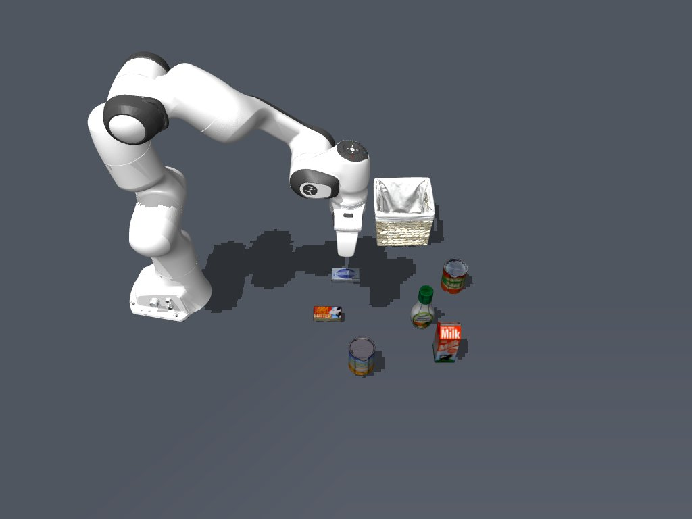

# 多物体 pick 系统侧验收

2026-11-12，4090-2，feat-pi05-intergration。本轮按“先不评价 pi05 能力，系统支持不同物体 pick”实施。系统已接通按 Ego ID 选物体、动态策略指令、目标尺寸相关准入、单独抓起判定及停止；原有汤罐入篮任务保留。此报告不声明六物体均已被 pi05 实抓成功。

## 系统能力

| 项目 | 状态 |
| --- | --- |
| 当前六类小物体识别、Ego 查询与 graspable 标记 | 通过；类别来自 RGB-D 与静态类别先验，标为 inferred |
| pick(target) 绑定 ID、类别、尺寸、初态和指令 | 通过；选 milk 不再把 prompt 固定为 alphabet soup |
| 只 pick 与原 libero_pick_place 区分 | 通过；pick 不要求篮子，不将抓起当放置 |
| RGB-D 抬升与手爪耦合 | 六种物体高度的受控正例通过 |
| 空夹爪、静止物体、缺视觉、重复帧、裁剪和串换负例 | 通过；三类审查发现的假抬升均加入失败回归并修复 |
| 推理中停止、模型加载时关闭、绑定失败恢复 | 通过 |
| 预测拒绝后禁止自动重试，Reset 后恢复 | 通过；skill_stop 不能清除策略故障锁 |
| 真实 pi05 对六物体的成功率 | 未验收，属于后续策略能力验证 |
| 非汤罐的一般 place、全量语义负例、6D 姿态 | 未纳入本轮 |

## 六物体真实 WSim/HTTP 批次

详见 [system-results.json](system-results.json)。每个目标独立创建初态 0 的物理环境，调用真实 Ego API 准入、Job、5 条动作及停止清理。使用明确的 explicit-noop-system-test 策略，因此预期物体未被抓起，Job 应失败 / not_achieved / confirmed；systemCheck=passed 表示接口和失败判定正确，不表示抓取成功。

| 物体 | 指令 | 系统检查 | Job 目标 / 停止 |
| --- | --- | --- | --- |
| alphabet_soup | pick up the alphabet soup | passed | not_achieved / confirmed |
| milk | pick up the milk | passed | not_achieved / confirmed |
| butter | pick up the butter | passed | not_achieved / confirmed |
| cream_cheese | pick up the cream cheese | passed | not_achieved / confirmed |
| salad_dressing | pick up the salad dressing | passed | not_achieved / confirmed |
| tomato_sauce | pick up the tomato sauce | passed | not_achieved / confirmed |

完整每回合 receipt、Job、逐动作记录和双相机传感器帧保留在 4090-2：

```text
/home/huawei/hqk/workspace/steward/steward/var/pi05-multi-object-pick/system-batch/
```

## 普通聊天与真实 pi05

普通聊天输入 `pick up the milk` 已选中本轮 milk 的 Ego ID，并在真实推理请求中使用 pick up the milk，详见 [live-chat-milk.json](live-chat-milk.json)。两次 Job 均为 pick，第一回合执行 35 条动作，随后动作轨迹因 Observed obstacle intersects tool sweep 被拒绝；模型随后自行重试 1 条动作，两次均 failed / unconfirmed / confirmed，没有报告抓取成功。

该聊天发生在最终重试故障锁加入之前，作为发现问题的开发记录保留。已新增故障锁：pick 轨迹被拒后必须 Reset，不能靠新的预测或 skill_stop 自动重开动作；该拒绝、停止不解锁、Reset 恢复的真实 HTTP 回归通过。本轮未反复调整 pi05 prompt、模型权重或绕过预测检查来追求成功。

原始聊天、World/Ego 采样帧和请求状态在：

```text
/home/huawei/hqk/workspace/steward/steward/var/pi05-multi-object-pick/live-chat-milk/
```

两个真实策略 Job 的原始数据目录记录于 live-chat-milk.json 中的 rawJobDirectory，含 external/、wrist/、sensors/、actions.jsonl、prefix-*/observation.json 和 stop.json。双相机原始帧保留原处，不复制到 Git。

## 验证与复现

最终相关 Python 回归 110 passed（134.49 s），Ego 工具与候选能力 16 passed；结果见 [python-tests.log](python-tests.log)，Ego 工具与候选能力检查见 [tools-tests.log](tools-tests.log)。DSH TypeScript 构建通过；独立执行的厨房 cup-to-table 集成检查停在旧 look_around 转向不收敛，开始前的 cad30310b3 临时源码快照也复现 yaw error 约 1.56 rad，详见 [kitchen-baseline.log](kitchen-baseline.log)。未将该旧基线失败算作通过，也未为本次 pick 扩展修改厨房转向。

```sh
cd /home/huawei/hqk/workspace/steward/steward
MUJOCO_GL=egl OPENBLAS_NUM_THREADS=1 .venv/bin/python scripts/verify_panda_multi_pick.py \
  --out var/pi05-multi-object-pick/reproduction
MUJOCO_GL=egl OPENBLAS_NUM_THREADS=1 .venv/bin/python -m pytest \
  tests/test_panda_pick.py tests/test_panda_jobs.py tests/test_observed_surfaces.py \
  tests/test_panda_visual_model.py tests/test_panda_self_model.py tests/test_mesh_visuals.py \
  tests/test_views.py tests/test_scene.py tests/test_chat.py tests/test_embodiments.py -q
```

源代码、测试、通用能力模板和本报告提交到 feat-pi05-intergration，不自动推送。当前系统使用说明位于仓库 steward/docs/panda-pick.md；源码散列见 source-sha256.json。



[当前初态完整摘要](ready-summary.json) · [World 视图](ready-world.jpg)
