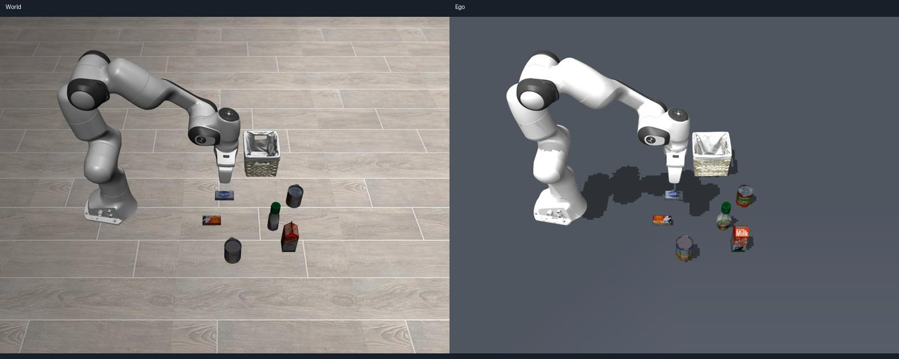

# Panda Ego 物体显示修复实测

2026-11-12，4090-2，分支 feat-pi05-intergration，初态 0。汤罐使用了正确 alphabet_soup 网格与贴图，但原生 +Y 轴未转为直立 +Z，因此看起来像横放的盒装物体；其余物体则被仅生成汤罐、篮子的任务感知路径遗漏。

已修复汤罐类别模板坐标轴，增加独立后台 RGB-D 可见表面提取，并接入公共 EgoViewRenderer。初态显示汤罐、篮子和另外五个物体。五种额外外观由观测色相和高度匹配静态类别先验，未知物体的语义仍为 unknown；证据不足时显示实际彩色表面。未读取 World State 名称、掩码、初态物体位姿或成功信号来生成 Ego State。

| 验证 | 结果 |
| --- | --- |
| 真实相机快照重放 | 7 个对象；五种包装外观人工核对正确 |
| 真实聊天回合一 | Job panda-job-c3b005240e824107b1aaf4e7b01ff13c，150 动作，succeeded / achieved / confirmed |
| 后台处理版本聊天回合 | Job panda-job-1e0ba6bf858c487a8333d595a795af90，160 动作，succeeded / achieved / confirmed |
| 最终遮挡修复版本聊天回合 | Job panda-job-31d89ac6c5e94bca9f369fadebd18993，165 动作，succeeded / achieved / confirmed |
| 关联回归 | 70 passed，72.63 s；见 final-tests.log |
| 最终外观、未知回退和公共视图 | 23 passed，23.64 s；见 appearance-tests.log |
| 后台重建开启时执行中停止 | 原有小于 4 s 的停止断言通过；见 background-stop-test.log |
| 目标遮挡回归、外观、后台停止 | 10 passed，13.47 s；见 occlusion-tests.log |
| 真实夹持序列重放 | 18 个抽样帧中，未排除目标区域时 10 帧出现 butter 错配，修复后 0 帧；见 held-replay.json |

上述测试有重叠，不将次数相加为独立用例数。开发中曾发现同步重建使停止测试变慢，修复为后台线程在策略观测锁外重建后复测通过。另在新外观匹配路径中发现夹持遮挡负例：目标蓝色标签消失后，剩余片段会生成新的 unknown 并被匹配为 butter；现使用目标最近视觉位置和已确认夹持区域排除这些片段。最终抓放采用真实 pi05_libero 和原始英文聊天输入，未为显示修复修改策略动作或成功判据。本轮验证显示与链路回归，不替代多初态、通用识别负例或完整 6D 姿态验收。



[抓起后的对照](held.jpg) · [完成后的对照](finished.jpg) · [最终 Job 与 Ego 摘要](final-summary.json) · [初态摘要](initial-summary.json) · [视图状态](view.json)

## 复现

在 4090-2 上运行：

```sh
cd /home/huawei/hqk/workspace/steward/steward
MUJOCO_GL=egl OPENBLAS_NUM_THREADS=1 .venv/bin/python scripts/check_panda_ego_visuals.py \
  --out var/ego-view-check
MUJOCO_GL=egl OPENBLAS_NUM_THREADS=1 .venv/bin/python scripts/check_panda_ego_visuals.py \
  --packet var/pi05-ego-object-diagnosis/initial-packet.json \
  --out var/ego-view-replay
MUJOCO_GL=egl OPENBLAS_NUM_THREADS=1 .venv/bin/python -m pytest \
  tests/test_observed_surfaces.py tests/test_panda_visual_model.py \
  tests/test_panda_self_model.py tests/test_mesh_visuals.py \
  tests/test_views.py tests/test_panda_jobs.py tests/test_scene.py -q
MUJOCO_GL=egl OPENBLAS_NUM_THREADS=1 .venv/bin/python \
  ../self/design/pi05-intergration/steps/step8-results/ego-object-visuals/replay-held-surfaces.py \
  --sensors-dir var/step4/wsim-root/runs/20261111-170927/ego-panda/policy-jobs/panda-job-1e0ba6bf858c487a8333d595a795af90/sensors \
  --out var/held-replay.json
```

只读脚本输出 packet.json、external.png、wrist.png、ego-replay.jpg 和 report.json。快照重放没有历史抓放证据，故不用于重新判断已经结束的 Job 是否成功。

实时链路：服务初态 0 就绪后，在 robot 聊天框发送 `pick up the alphabet soup and place it in the basket`。本机转发为 `ssh -N -L 17400:127.0.0.1:7400 rtx-4090-2`，访问 http://127.0.0.1:17400/console。

## 录像与原始数据

录像保留在 4090-2 原目录，不纳入 Git：

```text
/home/huawei/hqk/workspace/steward/steward/var/pi05-ego-object-diagnosis/final-live/
  pair.mp4           World/Ego 并排
  world.mp4          World 单视图
  ego.mp4            Ego 单视图
  world-*.jpg        World 逐帧
  ego-*.jpg          Ego 逐帧
  pair-*.jpg         并排逐帧
```

上述为控制台采样帧按 2 fps 编码的显示检查录像，非 20 Hz 策略相机录像。完整传感器原始帧、逐动作日志、推理和停止回执位于：

```text
/home/huawei/hqk/workspace/steward/steward/var/step4/wsim-root/runs/20261111-170927/ego-panda/policy-jobs/panda-job-31d89ac6c5e94bca9f369fadebd18993/
```

只读复现的完整输出位于 `/home/huawei/hqk/workspace/steward/steward/var/pi05-ego-object-diagnosis/reproduction/`；遮挡修复前的控制台录像保留在同级 pre-occlusion-live/，重放使用的历史传感器目录见上方命令。其他诊断、原始相机包和测试原日志保留在其父目录。代码、精简实测夹具、本文及摘要图片提交到当前分支；未推送。
