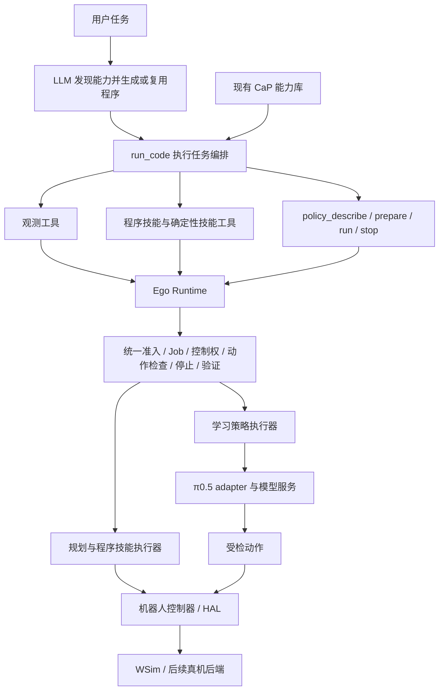

# CaP 与 VLA 互补的总体设计

状态：待实现方案，2026-11-17。本文定义架构与能力发现；字段、生命周期和验收要求见[接口契约](interfaces.md)。当前运行行为见 [π0.5 接入设计](../pi05-intergration/pi05-integration-design.md)。

本方案遵循 [Steward 零侵入约束](../../../steward.md)，保留能力库现有 list/get/save/delete 接口，不新增 cap_run、capability_run 或 LLM 原生策略入口。

## 1. 与 GR00T 2 的关系

GR00T 2 的推理 Agent 使用 WAM 和 CaP 技能，并展示了任务级程序调用 WAM 的方式；其实际机器人流程也可在程序技能修复场景后将控制权交回 WAM。Steward 采用任务程序调用学习策略的入口，保留程序技能与学习策略的互补关系，不要求首期实现原生策略工具入口。[NVIDIA 原始说明](https://research.nvidia.com/labs/gear/gr00t-2/)

程序技能实现明确的几何、规划和控制方法；VLA 根据视觉、语言和本体状态生成动作。二者均可承担完整的已支持任务或已验证操作段。任务编排代码负责选择、组合、检查和恢复；`run_code` 承载代码执行。程序技能和编排代码都可写成 CaP，不能据此把 VLA 理解为只供程序技能使用的下级控制器。

π0.5 首期仅作为动作策略接入，不具备 GR00T 2 WAM 联合预测未来视频的能力。未来 adapter 可以提供带来源、时间和预测跨度的预测观测，但这些内容不得写成 ES 实际观测或成功证据；视觉点位引导也必须由模型明确支持，不能假设给 π0.5 画标记即可生效。

## 2. 总体结构



模型服务输出经 ER 检查后才进入控制器；上图的模型链路始终受公共执行管理约束。首期只有现有 WSim 后端，不因架构预留真机而宣称真机已接通。

现有 Ego bundle 保持 `mode: ptc`，LLM 通过工具说明和生成的程序工具声明获知可用函数，所有调用仍发生在 `run_code` 内。无需 mixed 模式、动态切换呈现模式或改写 Harness 的保留工具 `run_code`。

## 3. 能力发现与任务选择

会话上下文提供当前本体的简短能力摘要，包含可复用 CaP、已配置策略入口及验证范围；详细策略信息通过程序调用 `policy_describe` 获取。摘要与详细描述读取同一注册信息，面向模型的内容按现有日志机制可重建，不从提示词另维护一份策略清单。

选择顺序：LLM 优先查找匹配且验证条件适用的 CaP；无合适程序时，根据任务、当前场景和已验证范围生成程序，选择确定性技能、学习策略或组合。已有 CaP 在程序中引用策略入口；临时程序由 LLM 选择入口。`policy_prepare` 再校验实际配置和当前状态，LLM 的选择不能授权执行。

| 任务情况 | 选择依据 |
| --- | --- |
| 观测、查询对象 | 观测工具 |
| 有成熟规划／程序技能的操作 | 确定性技能或已保存 CaP |
| 当前 Panda LIBERO 汤罐抓放 | 可选择已验证 π0.5 入口 |
| 多步操作、条件判断、结果检查 | 编排程序组合上述能力 |
| 新物体、新布局、未验证操作段 | 按注册范围标为未验证，只有部署允许的实验才可执行 |

“抓取”一词、模型接受自然语言、对象能在 ES 中找到，都不足以证明模型能够完成任务。固定汤罐场景的 cream cheese 已有失败证据，不应推荐为可靠能力。描述使用任务语义帮助选择，不使用不受验证记录约束的“通用桌面操作”宣传。

## 4. 策略注册与本体配置

稳定策略入口描述已部署的执行能力，配置将其绑定具体模型；模型版本更新不要求所有 CaP 改名，但新的组合必须重新确认验证范围。`panda.libero_manipulation` 是拟定入口 ID，`pi05_libero` 是 provider ID。执行记录同时保留入口配置版本、adapter、代码、模型权重和归一化身份；不能只记稳定名称。

策略注册数据包括：入口 ID、provider、本体与控制器兼容条件、相机及状态协议、任务描述与说明标签、验证记录和证据引用、已知失败、支持的条件输入、完成验证器、预算上限与实验许可。操作标签仅用于发现，不把语言接口限制成 `pick`／`libero_pick_place` 枚举。字段示意见[策略描述契约](interfaces.md#2-policy_describe)。

```yaml
# 已有本体配置；不是策略请求参数。
mechanical:
  grasp:
    sim: contact
```

`mechanical.grasp.sim` 决定仿真物体夹持方式；策略入口决定谁生成动作，CaP 决定如何组织调用。三者独立配置，但准入必须校验兼容组合。当前 Panda 的 π0.5 物理抓放证据绑定 contact；不能把 ideal-attach 的成功当成双指物理抓取通过。LLM、CaP 和 adapter 均不得临时切换抓取后端。配置解析及实体能力要求以[抓取仿真配置](../../../steward/docs/grasp-simulation.md)为准。

## 5. 实现职责与边界

| 模块 | 拟议职责与复用位置 |
| --- | --- |
| 策略 Service Definition／工具／HTTP provider | 在 Steward 自有 DSH 包和 Ego API 中完整定义声明、提供者、消费者；程序内工具调用经过公开守卫流程 |
| π0.5 adapter | 从现有 panda_policy 抽出图像处理、8 维状态编码、模型请求、动作解码；通用协议不固定动作维度 |
| 学习策略执行器 | 复用 panda_jobs 的推理与受检动作循环，抽出指令、预算与完成条件 |
| 公共执行管理 | 共享机器人控制权、收据校验、Job 查询、动作代际和停止；每台机器人首期仅一个运动 Job |
| 任务验证器 | 从现有抓放证据中抽出注册验证器，读取实际机器人观测，声明适用对象、条件和不确定性 |
| CaP 能力库 | 保留 list/get/save/delete 和 `(tools,args)` 程序形式，仍在 run_code 中执行 |

策略 Job 不是另一个独立控制器。CaP 程序运行记录不占用机器人运动租约，否则会阻塞自己的子 Job；它记录并拥有这些子 Job。程序可单独使用确定性能力、单独启动 π0.5，也可在确认停止并重新观测后交替调用两者。

原有能力库的代码无异常统计不能直接证明物理成功。后续能力验证需要关联程序版本、执行条件、子 Job 和实际目标证据；已有记录保留原始验证口径，不批量改写为新口径已通过。

## 6. 本次范围

本次只交付设计与接口契约，未安装新工具、未改变提示词、未更换运行入口、未启动新的物理实验。最小链路开发和验收顺序见[迁移与验收](interfaces.md#8-迁移与验收)，原有实验数据继续作为基线。
