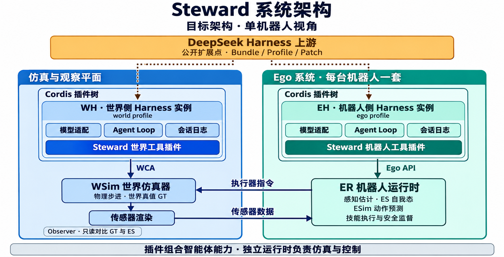
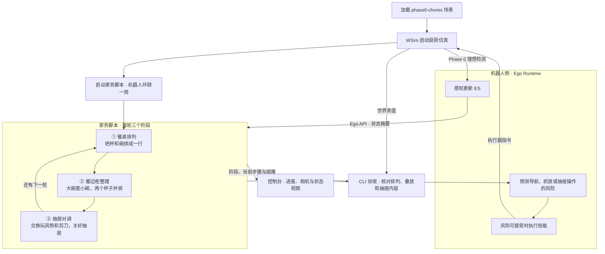
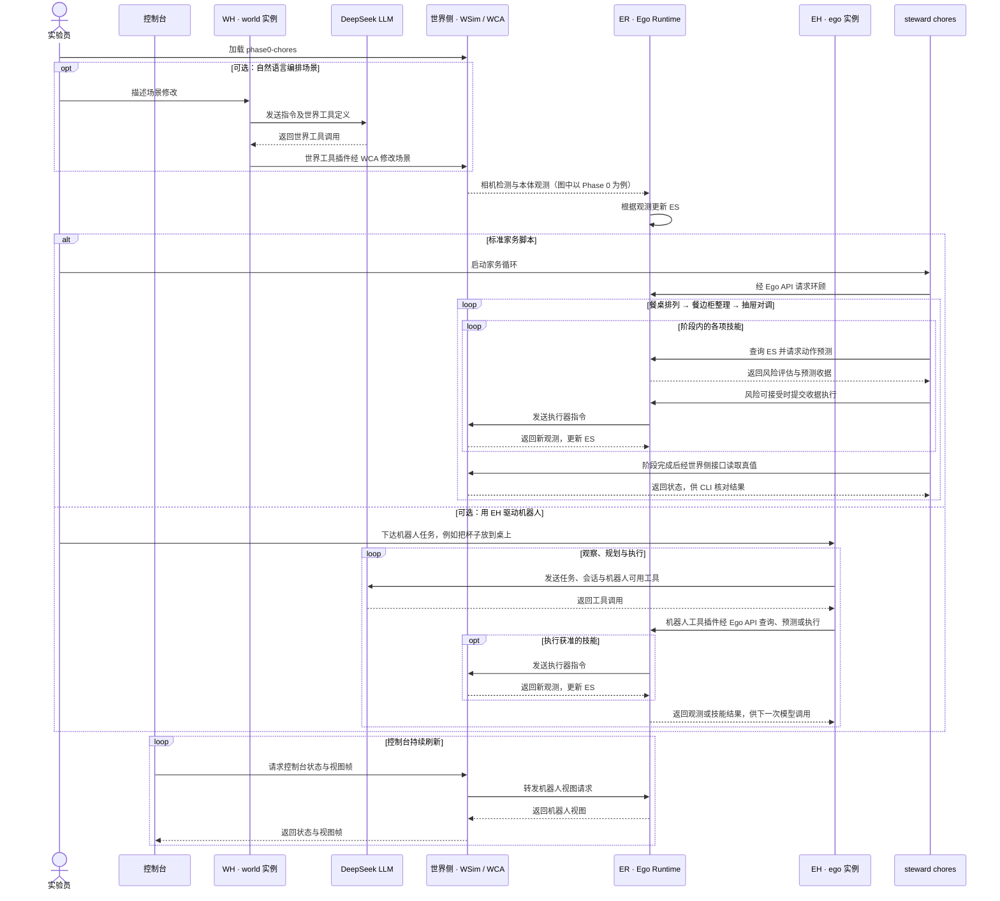

# Steward 架构解读

Steward 是一个机器人实验平台。它让机器人只凭自己的观测和记忆完成任务，同时让实验者对照世界真值，判断失败出在感知、规划还是执行。上图是单机器人视角下的目标架构。下文先解释组件分工，再用控制台的家务循环串起实际调用，最后对照原型进展。 [设计原文](../steward.md)

## 系统分工：从观测到执行

1. **世界仿真器 WSim** 推进物理仿真并维护世界真值（GT）。图中的「传感器数据」箭头表示世界状态经过传感器渲染后，以图像、深度等传感器数据进入机器人侧。
2. **机器人运行时 ER** 从观测估计杯子的位置和大小，将结果写入自己的状态 ES。杯子被移走后，ES 可能保留旧位置，直到机器人重新观察。
3. **机器人智能体 EH** 理解任务并选择走近、观察、抓取、放下等技能。ER 用基于 ES 的 ESim 评估动作后果，例如路径会不会撞桌腿，再负责技能执行和安全监督。图中的「执行器指令」箭头表示执行器指令返回 WSim。
4. **世界智能体 WH** 通过世界控制接口 WCA 布置场景和施加扰动。世界侧的 Observer 只读比较 GT 与 ES，可以区分机器人漏看了杯子、记着旧位置，还是找对了杯子但没抓起来。

WSim 回答「世界实际发生了什么」，ESim 回答「根据机器人当前掌握的信息，接下来可能发生什么」。GT 和 ES 可用同一套场景结构描述，但分别保存真值和估计值，使用各自的实体 ID 和坐标系。GT 只在世界侧可读。

## 控制台案例：phase0-chores 家务循环

`phase0-chores` 选定厨房场景，感知级别单独配置。控制台展示仿真与任务进度，`steward chores` 脚本编排家务步骤。以 Phase 0 感知运行时，世界侧提供相机视角下的理想检测，机器人运行时据此维护 ES。脚本通过 Ego API 读取 ES 并调用技能，CLI 在阶段结束后读取世界真值核对结果。 [家务循环入口](../steward/src/steward/cli.py)

以抽屉对调为例，机器人走到柜前，打开抽屉后再观察里面有什么。脚本根据更新后的 ES 选择要搬运的物品，机器人运行时评估动作风险并执行抓放。阶段结束后，CLI 对比交换前后的世界状态，核对两件物品是否确实对调。 [家务步骤](../steward/src/steward/chores.py) · [阶段核对](../steward/src/steward/cli.py)

在无限循环模式下，脚本遇到阶段失败会记录原因并尝试恢复。反复卡住时，机器人先尝试后撤、巡视和重新感知，仍无进展时发布告警等待操作员处理。 [恢复逻辑](../steward/src/steward/chores.py)

### 两个 Harness 实例在什么时候介入？

上方虚线表示软件依赖。WH 和 EH 各自运行一棵由 profile 组装的 Cordis 插件树。两边都加载模型适配、Agent Loop 和会话日志等通用插件。Steward 的世界工具插件通过 WCA 调用 WSim，机器人工具插件通过 Ego API 调用 ER。WH 负责世界编排，EH 负责任务规划，物理步进和实时控制由各自的运行时负责。实机迁移的设计目标是替换传感器和执行器接口，复用上层任务规划和技能编排。

### 时序图：从脚本执行到模型驱动

上面的流程图回答一轮家务做哪些事。下面的时序图沿着同一个场景，看每一步由谁发起。标准演示走脚本分支。若用自然语言调整场景，由 WH 调用世界工具；若把机器人任务交给模型，由 EH 调用机器人工具。设计文档记录的 EH 验收任务是把杯子放到桌上。WH 和 EH 各有自己的插件和会话，可以调用同一个 DeepSeek LLM 服务。 [Harness 部署设计](../steward.md#61-需要几个-harness-实例) · [家务循环入口](../steward/src/steward/cli.py)

控制台和 CLI 验收可以读取世界真值。家务脚本的动作编排和 EH 的机器人决策都使用 Ego API 提供的观测与技能结果。

## 目标架构与原型进展

按设计文档第 13 节的记录，Phase 0 已跑通单机器人端到端链路，Phase 1 正在验证感知泛化。基线 `phase1` 使用模拟器提供的匿名实例掩码；`phase1-sam` 则在机器人侧从 RGB-D 自行分割。文档记录的厨房环顾实验中，单头部相机的召回率分别为 1.00 和 0.71，重复运行也有波动。这个对照显示，减少对模拟器提供的区域提示后，漏检和实例拆分会直接影响 ES 的质量。

原型已有简化的几何碰撞与抓空风险检查。完整的 ESim 物理推演、长时任务、多机器人协作和实机部署仍在路线图上。可以用原文 §4.1 看信息流、§6.8 看晚餐任务示例，再用 §13.1 和 §13.6 区分设计目标与已实现能力。
