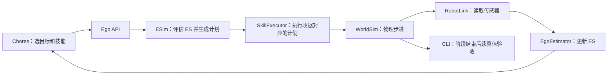

# Steward 机器人代码走读

本文以当前工作区基线 `971d7957fd` 为参照，从 `steward/` 的实际入口读到机器人动作落地。先沿着「打开抽屉、拿出玩具熊」走一遍，再回头看不同感知模式和两个 Harness 实例如何复用这条执行链路。已有的[架构解读](steward-architecture.md)提供全局图。

## 阅读顺序

1. [启动世界和机器人](#1-启动世界和机器人)
2. [跟一次抽屉交换](#2-跟一次抽屉交换)
3. [观测如何变成机器人自我态](#3-观测如何变成机器人自我态)
4. [从预测收据到物理动作](#4-从预测收据到物理动作)
5. [控制台、验收和故障恢复](#5-控制台验收和故障恢复)
6. [接入两个 DeepSeek Harness 实例](#6-接入两个-deepseek-harness-实例)
7. [按问题回查源码](#7-按问题回查源码)

## 1. 启动世界和机器人

`steward/` 里有两组代码。Python 的 `src/steward/` 管资产、仿真、感知、技能、任务脚本和控制台；TypeScript 的 `dsh/` 把世界侧和机器人侧的 HTTP 服务接成 Harness 工具。先读 Python 就能理解家务脚本的完整路径，再看 TypeScript 会更容易分清模型工具与机器人技能。

从 `cli.main` 看命令如何分发。常驻路径 `cmd_up` 先构造 `StewardHost`，拿到机器人的专用端口，再启动一个运行 `cmd_ego` 的 Python 子进程。子进程建好 Ego Runtime 和 Ego API 后，把 API 地址回报给父进程。Host 登记地址后启动仿真与控制台服务。家务命令既可连接这一套服务，也可在自己的进程里创建 Host、Runtime 和 API。 [CLI 入口](../steward/src/steward/cli.py)

场景从资产开始。资产生成器定义机器人、家具和可操作物体的几何与关节。AuthoringService 将资产按位置或支撑关系组合成场景，Scenario 再记录要加载哪个场景、有哪些机器人及任务描述。`chores_spec` 定义了餐具、餐桌、餐边柜和两只抽屉的初始布局。Host 加载 Scenario 后构造 WorldSim，WorldSim 将场景编译成 MuJoCo 模型。 [资产生成器](../steward/src/steward/assets/generators.py) · [场景构建](../steward/src/steward/authoring/service.py) · [Host](../steward/src/steward/world/server.py) · [MJCF 编译](../steward/src/steward/scene/mjcf.py)

沿源码追踪时，先分清这三套接口：

| 接口 | 调用方 → 提供方 | 追踪时看什么 |
| --- | --- | --- |
| WCA 与控制台路由 | 实验员、控制台、WH → StewardHost | 场景加载、世界编辑、真值、观察报告和视图转发 |
| 每机器人专用端口 | ER 的 `RobotLink` → StewardHost → WorldSim | `/sensors`、`/sensors/rgbd`、`/command`、`/telemetry` 和仿真时钟 |
| Ego API | 家务脚本、EH → `ego.server` → EgoRuntime | `/ego/summary`、`/ego/predict`、`/skill/run`、`/skill/wait` |

这里的 **WS** 是仿真世界状态，**ES** 是机器人对世界的估计。两者用 `SceneState` 表示，含实体、关系、坐标系和时间。读 `schema.py` 时留意 `Est` 如何给估计值附上不确定度，以及实体怎样由 Link 与 Joint 组成。当前 Python 实现用 dataclass 表达状态，HTTP 路由交换 JSON 或二进制图像数据。机器人端口提供传感与执行接口，完整世界状态从世界侧接口读取。 [场景类型](../steward/src/steward/scene/schema.py) · [Ego 路由](../steward/src/steward/ego/server.py) · [接口隔离测试](../steward/tests/test_e2e.py)

## 2. 跟一次抽屉交换

`cmd_chores` 把 Ego API 地址交给 `chores()`。脚本先发起环顾，再按固定顺序调用 `arrange_on_table`、`stack_on_sideboard` 和 `swap_drawers`。前两个阶段分别把餐具排到餐桌上、把碗套叠到餐边柜并放好杯子。第三个阶段交换抽屉里的玩具熊和剪刀，然后关好抽屉。 [CLI 入口](../steward/src/steward/cli.py) · [家务任务](../steward/src/steward/chores.py)

以第三阶段为例，可以带着下面四个问题读 `swap_drawers` 和它调用的辅助方法：

1. **去哪儿？** 从 ES 摘要找柜子和抽屉。靠近家具、转向正面，再读取更新后的摘要。角色识别、类别和已有轨迹都可能影响脚本选中哪个对象。
2. **抽屉里有什么？** 请求打开抽屉并等待技能结束。抽屉内容露出后，重新感知才能获得可用于抓取的轨迹和支撑关系。
3. **怎么搬过去？** 用轨迹 ID 请求抓取和放置预测。动作可行且风险可接受时，把收据 ID 交给执行器并等待 job。遇到遮挡、抓空或可移动障碍时，再读任务层如何近看、重试或清障。
4. **交换成功了吗？** CLI 的阶段回调比较交换前后的世界状态。脚本选目标用 ES，验收用世界真值。把这两条路径分开读，才能判断一次失败是世界没变，还是 ES 没跟上。

`mission._run` 是跟踪单次动作最短的入口。它提交收据，取得 job，再通过 `/skill/wait` 等结果。job 未成功时抛出 `MissionFailed`。环顾走单独的 `/ego/explore`，由 Runtime 启动原地转动技能。 [任务调用辅助函数](../steward/src/steward/mission.py) · [家务阶段验收](../steward/src/steward/world/chores_check.py)

## 3. 观测如何变成机器人自我态

从 `EgoRuntime._loop` 和 `_poll_once` 开始读。循环按仿真时间取帧，从本体观测和相机信息选择估计路径，发布 ES 视图快照，并周期性把 ES 遥测发回观察器。等待仿真时钟和等待真实时间是两回事。读到时钟占用、释放或续租时，回到 `RobotLink` 与 `WorldSim.wait_until`，看采样和技能怎样在同一条仿真时间线上协调。 [Runtime](../steward/src/steward/ego/runtime.py) · [仿真与时钟](../steward/src/steward/world/sim.py)

`phase0-chores` 是场景名。Host 选择感知级别时，显式指定的级别优先，其次是场景声明，最后用调用方的回退级别。普通 CLI 的回退值来自 `LATEST_PHASE`。Runtime 依据传感帧的 `imaging` 和 `masks` 选择路径。切换感知模式时，已有的普通物体轨迹会重新建立，手中物体和正在运行的技能保留。 [感知级别](../steward/src/steward/phases.py) · [Host 的级别选择](../steward/src/steward/world/server.py)

| 感知级别 | 世界侧给什么 | 机器人侧怎么处理 |
| --- | --- | --- |
| `phase0` | 相机视角下带噪声的理想检测，加本体观测 | `EgoEstimator.update` 用相机位姿转换检测结果，关联轨迹并融合估计 |
| `phase1` | RGB-D 与匿名实例掩码 | `update_rgbd` 把像素和深度反投影为点，拟合有向包围盒，再结合尺寸、颜色等先验分类并多帧融合 |
| `phase1-sam` | RGB-D | Runtime 按相机选关键帧，`Segmenter` 调用 SAM 给出实例掩码和语义分数，再进入 RGB-D 估计路径 |

建议顺着一个杯子读 `perception.segments → EgoEstimator.update_rgbd → to_scene → EgoRuntime.summary`。单帧掩码上的编号用于区分当前图像的区域，持续的机器人对象身份来自 `Track`。轨迹会维护位置、几何、类别证据和存在置信度。估计器用后续视角更新轨迹，也会处理重复、暂时遮挡和有证据的消失。任务脚本看到的 `summary` 还包括 `on` 等关系、角色或操作所需的信息。遇到两台相机都能看到同一个目标时，从 Runtime 的 `_handoff` 读近远相机的分工。 [反投影与几何](../steward/src/steward/ego/perception.py) · [轨迹与 ES](../steward/src/steward/ego/estimator.py) · [类别先验](../steward/src/steward/ego/classify.py) · [角色识别](../steward/src/steward/ego/roles.py)

看 SAM 路径时，把关键帧、分割和估计当作三件事。Runtime 决定哪一帧值得请求，`segmenter.py` 处理整图与局部裁剪、语义分数和缓存，估计器才决定这些区域对应哪个物体。如果分割失败或没有可融合的图像，Runtime 仍能更新本体状态。其他视觉服务可以从 `perception_services.py` 和 `ego/providers/` 按需回查。 [SAM 分割](../steward/src/steward/ego/segmenter.py) · [服务清单加载](../steward/src/steward/perception_services.py)

## 4. 从预测收据到物理动作

选一个 `pick`，从 `ego.server._routes` 向下跟三层：

| 层 | 源码入口 | 该层决定什么 |
| --- | --- | --- |
| 预测 | `EgoRuntime.predict → Esim.predict → _predict_pick` | 以当前 ES 判断目标能否接近和抓取，生成风险、原因与计划 |
| 放行 | `EgoRuntime.run` | 检查控制权、收据是否已用、是否过期、动作是否可行和风险是否超限 |
| 执行 | `SkillExecutor.start → _run → _pick` | 启动技能 job，沿收据里的计划驱动底盘和夹爪，更新执行状态 |

`planner.py` 提供平面障碍物、网格和 A* 等几何工具。`esim.py` 在这些几何信息上做导航和操作预测。这里的 ESim 是基于估计状态的简化预测器。MuJoCo 的真实仿真步进发生在世界侧。执行时，技能通过 `RobotLink.command` 把底盘、机械臂和夹爪指令交给 `WorldSim.command`。当前抓取和抽屉交互也有原型规则，例如把捕获到的物体附着在夹爪、对抽屉把手施力。 [ESim](../steward/src/steward/ego/esim.py) · [路径规划](../steward/src/steward/ego/planner.py) · [技能执行](../steward/src/steward/ego/skills.py) · [世界动作处理](../steward/src/steward/world/sim.py)

调试时依次检查收据、job 和下一帧 ES。收据描述预计会发生什么，job 报告执行器发生了什么，下一帧 ES 显示机器人重新观察到了什么。若要确认结果是否真的落在目标位置，再看世界侧验收。

## 5. 控制台、验收和故障恢复

控制台浏览器请求 Host 的 `/console/state` 和 `/console/frame`。世界视图由世界侧渲染，机器人视图由 ER 根据 ES 渲染、经 Host 转发。家务脚本把轮次、阶段、当前步骤和困难发布到 `/ego/plan`，控制台经 Host 获取任务信息。看进度用 plan，看机器人信念用 Ego State，看实际摆放用 World State。 [控制台前端](../steward/src/steward/world/console.html) · [控制台状态](../steward/src/steward/world/console.py) · [Ego 视图](../steward/src/steward/ego/view.py)

验收有两个粒度。CLI 的 `on_phase` 检查每个家务阶段是否达到世界侧目标。Observer 则持续读取 ES 遥测，与世界真值配对，计算感知指标并记录异常。当前工作区的配对先按位置距离筛候选，再用距离与类别不匹配的惩罚排序，因此类别错误仍可能匹配。召回率关心真值物体匹配了多少，类别准确率关心已匹配的物体里有多少叫对了。 [Observer](../steward/src/steward/observer/observer.py) · [阶段回调](../steward/src/steward/cli.py)

有限轮数遇到阶段异常会抛出失败。无限循环会记录失败、尝试恢复并继续；重复出现同类失败或整轮无进展时，先尝试后撤、巡视和重新感知，反复活锁则发告警等待处理。若遇到「卡着不动」，先区分收据被拒、job 停滞、感知异常告警以及另一个调用方持有控制权。 [任务恢复](../steward/src/steward/chores.py) · [诊断](../steward/src/steward/diagnosis.py) · [运行时控制权](../steward/src/steward/ego/runtime.py)

## 6. 接入两个 DeepSeek Harness 实例

把家务脚本与 EH 放在同一张图上理解。两者都能通过 Ego API 查询和执行，区别在于谁选择技能和参数。家务脚本按 Python 逻辑选，EH 通过 DeepSeek LLM 和工具调用选。SAM 分割发生在 ER 的感知路径里，与 EH 的模型回合分别运行。

- **机器人侧 EH。** 先读 Ego bundle 的 `cordis.patch.yml`。它把 `dsh-ego-runtime-client`、`dsh-tool-ego`、`dsh-robot-safety` 等插件加入 profile。接口定义在 `dsh-ego`，HTTP Provider 实现 `ctx.ego`，工具插件把 `ego_predict`、`skill_run` 等动作交给模型调用。Harness 的工具守卫在发请求前检查收据，ER 在执行处复检，并负责以仿真时间判定收据是否过期。 [Ego bundle](../steward/dsh/packages/dsh-bundle-ego/cordis.patch.yml) · [服务定义](../steward/dsh/packages/dsh-ego/src/index.ts) · [HTTP Provider](../steward/dsh/packages/dsh-ego-runtime-client/src/index.ts) · [工具](../steward/dsh/packages/dsh-tool-ego/src/index.ts) · [工具守卫](../steward/dsh/packages/dsh-robot-safety/src/index.ts)
- **世界侧 WH。** 对照 `dsh-world`、`dsh-world-client` 和 `dsh-tool-world`，沿着接口定义、HTTP Provider、模型工具的相同顺序读。这套实例经 WCA 编排场景。世界侧工具和机器人侧工具指向各自的服务。 [World bundle](../steward/dsh/packages/dsh-bundle-world/cordis.patch.yml) · [World Provider](../steward/dsh/packages/dsh-world-client/src/index.ts) · [World 工具](../steward/dsh/packages/dsh-tool-world/src/index.ts)
- **控制台怎样接起模型。** `world/chat.py` 把世界对话和机器人对话映射到不同的 DSH home 与 profile。世界对话用 `world-task`，机器人对话用 `ego`。模型回合由 `dsh` 子进程承载，机器人对话在发起回合前请求控制权。需要理解模型怎样通过 PTC 编排多个机器人动作时，再读 Ego bundle 和 `dsh-tool-ego-capabilities`。 [控制台对话](../steward/src/steward/world/chat.py) · [能力复用工具](../steward/dsh/packages/dsh-tool-ego-capabilities/src/index.ts)

## 7. 按问题回查源码

| 想验证的问题 | 从这里开始 |
| --- | --- |
| 一件物体能否从观测、预测走到实际摆放？机器人端口能否直接读世界状态？ | [test_e2e.py](../steward/tests/test_e2e.py) |
| 三个家务阶段怎样分别用真值确认？叠碗和抽屉怎么表达？ | [test_chores.py](../steward/tests/test_chores.py) 的 `test_one_chores_round_is_confirmed_by_world_state` 和相邻用例 |
| 切换感知后，ER 怎样跟随新帧？轨迹为何合并或删除？ | [test_phase.py](../steward/tests/test_phase.py) 与 [test_segmenter.py](../steward/tests/test_segmenter.py) |
| 技能失败和告警怎样出现在控制台？ | [test_alerts.py](../steward/tests/test_alerts.py) |
| Harness 注册了哪些工具，收据怎样从模型工具传给 ER？ | [tools.test.mjs](../steward/dsh/test/tools.test.mjs) 和 [integration.test.mjs](../steward/dsh/test/integration.test.mjs) |

走完一遍后，可以试着解释这个现场问题：**控制台显示玩具熊还在旧抽屉，下一步该查哪儿？** 先用 World State 确认物品是否移动，再比对 job 和 ES。如果真值已更新而 ES 仍旧，沿传感帧、轨迹关联和支撑关系查。如果真值也没更新，回查收据里的计划、job 的执行结果和 WorldSim 对夹爪指令的处理。这样可以把任务编排、感知和执行分别定位到对应源码。

### 本次走读的验证

本地运行了家务单轮和杯子上桌两个集成用例。家务单轮通过。杯子上桌用例中，抓取和放置 job 都返回成功，但任务随后读取 ES 时，杯子的 `on` 指向另一个实体，任务因此失败。这个结果只确认 ES 的支撑关系校验失败，测试在读取真值验收前已经退出。可以从 `mission._move` 的放置后检查和 `EgoEstimator.support_of` 接着读。 [放置后检查](../steward/src/steward/mission.py) · [支撑关系估计](../steward/src/steward/ego/estimator.py)
