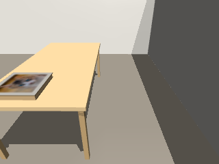
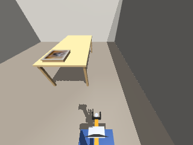
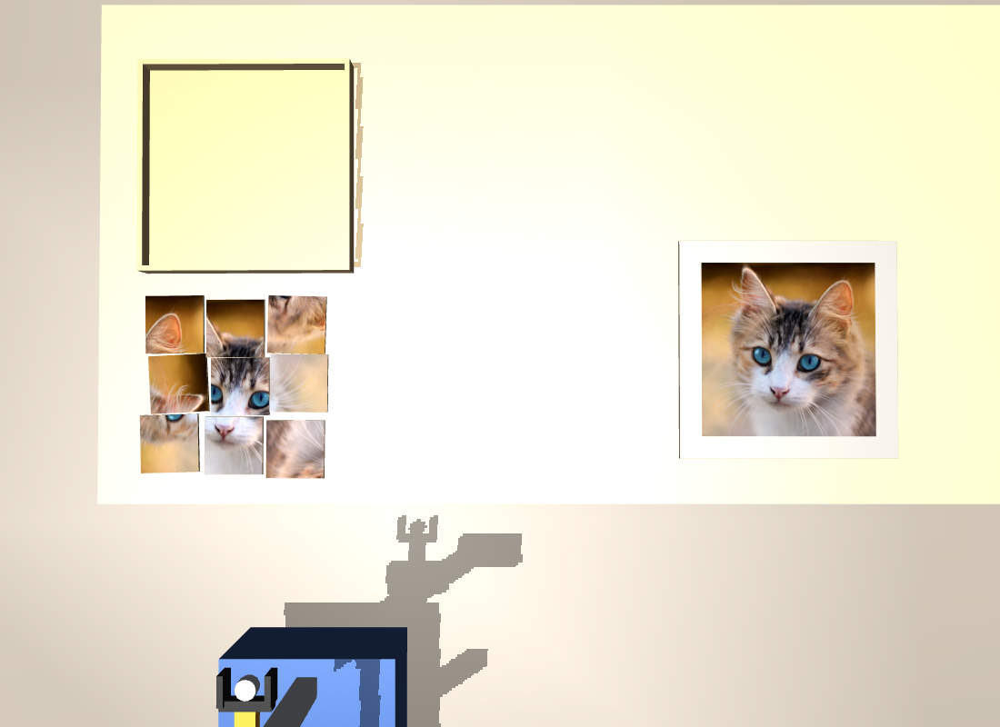
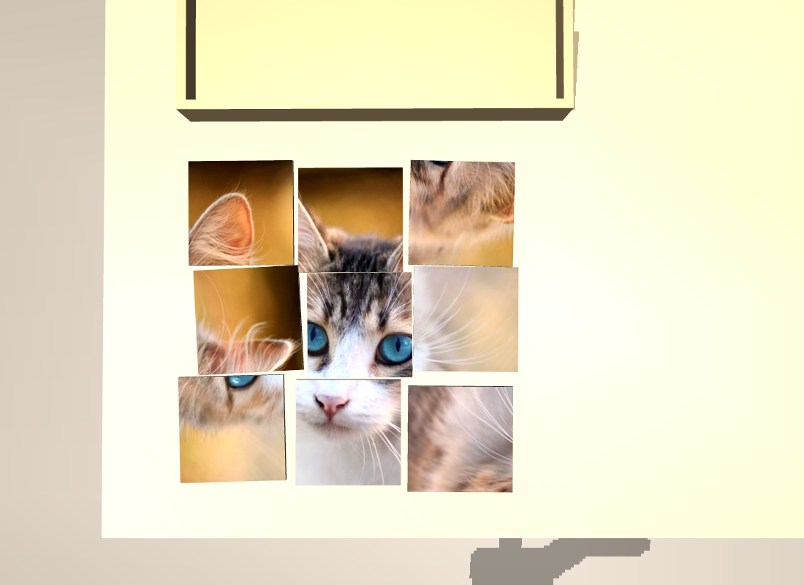
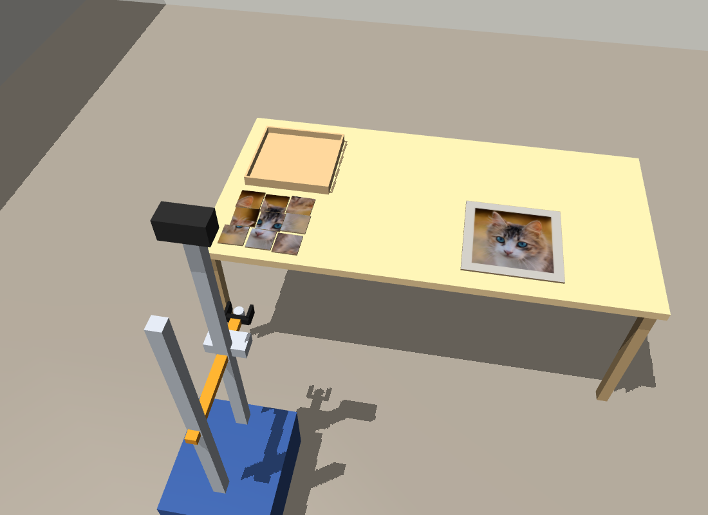

# puzzle-cat · Steward Bot · phase0

2026-11-10 这轮运行完成了开盒、倒出、翻面和 3×3 摆放。机器人自报拼图完成，世界侧判定未完成。正确邻接为 **2/12**，最大正确拼合组为 **3/9**。这轮可作为 Phase 0 的任务失败基线，用来比较后续运行的拼图正确率、观察成本和完成误报。

## 运行配置

| 字段 | 值 |
| --- | --- |
| Scenario 与本体 | `puzzle-cat`，`steward-bot`（机器人 `w:robot-1`） |
| 感知级别 | `phase0`，理想检测。Observer 记录确认本轮使用该级别 |
| 任务 | 开盒，将 9 块拼图倒在桌上，按盒盖图案拼成 34.5 cm 见方的猫图 |
| 墙钟 | 2026-11-10 10:50:20 至 11:24:30（UTC+08:00），约 34 分 10 秒 |
| 仿真 | 最后一个已记录技能在仿真时间 1971.4 秒结束。控制台取证时为 1×、未暂停，取证时间晚于任务结束 |
| 版本 | 归档时工作区 HEAD 为 `996d9764b7`。本轮进程对应的源码版本、模型、种子和推理配置未独立核实 |
| 会话 | `session-6ef26212-f0aa-45ab-9f12-a9350185a642`，1 轮 |

## 执行经过

1. **开盒和倒出。** 机器人先靠近桌面看盒盖，补充盒盖和盒子的可供性，移走盒盖，再将拼图倒在桌上。技能日志记录 1 次 `pour` 完成。会话读取了 `assemble_jigsaw_by_picture` 和 `flip_flat_objects_face_up` 两个已有能力。
2. **逐块翻面和取图。** 机器人判断倒出的九块都是背面朝上，逐块翻面。初次图案匹配不明确，随后换机位取图、提高网格分辨率，并按有效采样格数重新选取图案证据。
3. **匹配、摆放和返工。** 机器人根据图案得分求全局格位和朝向，再执行抓放。核对时一度报告两块叠在同一格、另有一格空着，随后分开重摆。技能日志共记录导航 19 次完成，抓取 37 次启动、36 次完成，放置 36 次启动、36 次完成。
4. **自查和退出。** 机器人报告合成图与盒盖的相关系数为 0.58，高于 40 次随机打乱的最高值 0.43（中位数 0.18），据此宣布完成。相关分数来自机器人自查，未独立重算。随机对照能说明相对相似度，单块格位和朝向仍需逐一核验。

## 独立判分

| 项目 | 结果 |
| --- | --- |
| 桌面状态 | 9 块均在桌面，图案面朝上。取证时各块中心高度均为 0.753 m |
| 正确邻接 | `01 → 11` 和 `11 → 21`，位置误差分别为 0.97 cm 和 1.34 cm |
| 位置接近但朝向错误 | `21 → 22`，位置误差 1.04 cm，朝向误差 179.68° |
| 其余失败邻接 | 位置误差约 12–27 cm。逐条误差见 [终态快照](final-state.json) |
| Observer | 最后技能结束后的首条采样匹配到 12/12 个受评对象，含全部 9 块拼图。平均位置误差 1.89 cm，误检 0 |
| 结果 | 机器人自报完成。世界侧为 `complete=false`，记为一次完成误报 |

## 运行截图

### 开场观察

仿真时间 5.83 秒，机器人首次观察时保存的头部与广角相机原图。盒盖仍在盒子上。运行日志中能按时间确认属于本轮的过程截图只有这一对。

 

### 最终结果

任务结束后从仍在运行的仿真场景渲染了三张图。渲染前核对了场景、感知级别、九块拼图的坐标与朝向以及目标判分，均与[归档终态](final-state.json)一致。

**拼图与参照对比。** 左侧为机器人排出的九块拼图，右侧为盒盖上的目标图案。中间一列基本连贯，两侧可以看到错格或旋转造成的断裂。

**拼图区特写。** 九块都在桌上且图案面朝上，世界侧判定正确邻接 2/12。

**世界斜俯视。** 图中同时可见机器人、空盒、拼图与盒盖。

## 后续对照

同一初态对比 `phase0` 与 `phase1-sam` 时，分别记录倒出后可识别块数、九块全部翻正所需动作、求解出的格位与朝向、摆放后的实际状态、最终邻接及自报结果。当前记录无法区分错配源自外观取样、求解还是放置后复核。下次保留逐块候选分数、指派结果和放置后验证，便于定位首次出现差异的阶段。世界真值用于离线评分，机器人完成判断使用自身观测。

## 附件

- [终态快照](final-state.json) 保存控制台取证时的世界判分、物体位姿、Observer 指标和近期事件。近期事件是有限窗口。
- [末次技能附近的 Observer 采样](observer-at-last-skill.jsonl) 保存仿真时间 1971.26 秒和 1971.76 秒的两条原始记录。
- [工具调用统计](tool-counts.json) 从会话事件汇总。外层 `run_code` 共 96 次，内层 `ego_inspect` 233 次，`ego_match_face` 17 次，其中 2 次标记为错误。
- [任务与技能活动](task-activity.json) 保存任务原文、机器人最终回复和 186 条控制台技能活动。
