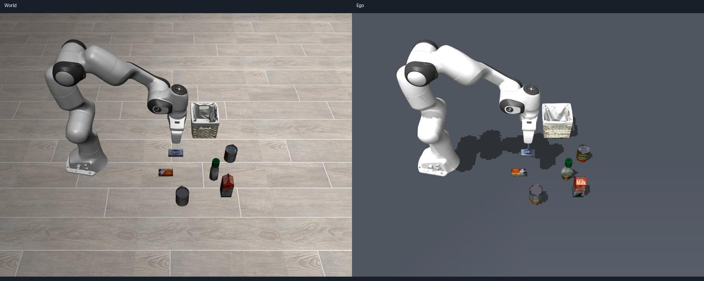

# Panda Ego State 可视化

Panda 与厨房场景共用 `SceneState → build_mjcf → EgoViewRenderer → ViewLoop → Ego API`。保留已知本体外观，编码器更新关节；不使用单独的 Panda 渲染器。

机器人标定用于构建 15 个连杆节点、9 个活动关节的完整自模型。渲染副本使用静态资源中的机器人视觉网格，保留贴图。汤罐、篮子的显示位置来自 RGB-D Ego State；类别视觉先验只决定外观，不补入未感知物体。HOPE 汤罐模型的原生轴为 +Y，显示时转换到 Ego 直立估计的 +Z，避免横放后看起来像盒装 butter。标签贴图仍为 alphabet_soup，不存在 butter 资源替换。

后台观测线程从外部 RGB-D 中提取其余可见表面，排除地面、标定本体和已知任务物体区域，以相邻像素生成带颜色的三角形，并拒绝跨深度边界的面。目标的最近视觉位置和已确认夹持区域也保留为排除区，避免标签被手指遮挡时将汤罐碎片重分类为 butter。未知物体进入 Ego State，带观测时间和相机来源，不再因任务识别只覆盖汤罐、篮子而消失。重建在策略观测锁外执行，避免增加停止确认的等待。

对未知物体，显示副本根据有颜色像素的色相分布和实测高度匹配静态类别外观，可信差距不足或外观无信息时保留实际测量表面。匹配不修改语义类别，额外物体在 Ego API 中仍为 unknown；完整外观和部分旋转来自类别先验，不表示已完成通用语义识别或 6D 姿态恢复。初态 0 已核对 salad_dressing、cream_cheese、milk、tomato_sauce、butter 五种外观。

静态资源以 SHA256SUMS 校验，不读取初态文件或 World State API。物体模板的根位姿在编译前归零，再按自身几何居中。模型加载位于观测锁之外，GL 资源仍归公共视图线程所有。

共享转换器支持 `geometry.visual` 的 mesh 表示：`data` 为 Base64 OBJ，`meshTexture` 为可选 Base64 PNG，`pose` 与 `rgba` 沿用几何字段。视觉网格不参与碰撞；碰撞继续使用原有 primitive。带视觉几何的物体走公共固定实体分支，按 SceneState 更新位置，其他包围盒保留原槽位缓存。MuJoCo 编译后的 UV 导出时恢复 V 轴约定，使用原始贴图和与 WSim 一致的线性色彩空间。公共 EgoViewRenderer 每帧追加 `geometry.observed` 中 kind=surface 的测量三角形，位置为实体根坐标系内的 triangles，每面 rgb 为三个颜色字节；这些面不进入仿真，也不要求重新编译机器人网格。

2026-11-12 关联回归 70 项通过；外观与视图追加回归 23 项通过，最终遮挡、外观和后台停止回归 10 项通过。真实夹持序列的 18 个抽样帧排除了碎片错配；后台重建开启时停止仍满足原时限。真实聊天抓放开发回合执行 150、160 条动作，最终遮挡修复版本执行 165 条动作，均 succeeded / achieved / confirmed。实测、命令、日志与录像路径见 [Ego 物体显示修复报告](../../self/design/pi05-intergration/steps/step8-results/ego-object-visuals/README.md)。此前的 95 项基础验证日志仍保留。

只读重放可运行 `MUJOCO_GL=egl OPENBLAS_NUM_THREADS=1 .venv/bin/python scripts/check_panda_ego_visuals.py --out var/ego-view-check`，或增加 `--packet 已保存的packet.json` 离线复现。输出包含相机图像、Ego 渲染图、观测和外观匹配报告，不执行机器人动作。

[最终验证日志](panda-ego-view-tests.log)
